# 🗺️ Q.S.C. System — แผนผังความสัมพันธ์ฐานข้อมูล (ER Diagram)

> **เวอร์ชัน:** 4.1 (SQL Server Migration — 25 ตาราง + AI Analysis + Standard Audit Columns)
> **อัปเดตล่าสุด:** 16 กันยายน 2569
> **ฐานข้อมูลเป้าหมาย:** Microsoft SQL Server (`QSCDB`)
> **อ้างอิงจาก:** [`backend/QSC.Api/Data/AppDbContext.cs`](backend/QSC.Api/Data/AppDbContext.cs) และ [`backend/QSC.Api/Models/`](backend/QSC.Api/Models/)

---

## 📑 สารบัญ

1. [แผนผังรวม (ER Diagram)](#-แผนผังรวม-er-diagram)
2. [คอลัมน์มาตรฐาน (Audit Columns)](#-คอลัมน์มาตรฐาน-audit-columns)
3. [พฤติกรรมการลบ (Delete Behavior)](#-พฤติกรรมการลบ-delete-behavior)
4. [ดัชนี (Indexes)](#-ดัชนี-indexes)

---

## 🗺️ แผนผังรวม (ER Diagram)

ตัวเลขในคำอธิบายคอลัมน์ = ความยาวสูงสุดของ `nvarchar` (ไม่ระบุ = `nvarchar(max)`)
คอลัมน์มาตรฐาน 5 ตัวมีครบทุกตาราง จึงไม่เขียนซ้ำในแต่ละกล่อง ดู[หัวข้อถัดไป](#-คอลัมน์มาตรฐาน-audit-columns)

```mermaid
erDiagram
    %% ===== Domain 1: Users & RBAC =====
    Role ||--o{ User : "RoleId"
    Role ||--o{ RolePermission : "RoleId"
    Permission ||--o{ RolePermission : "PermissionId"
    User ||--o{ UserLocation : "UserId"
    User ||--o{ UserBrand : "UserId"
    Location ||--o{ UserLocation : "LocationId"
    Brand ||--o{ UserBrand : "BrandId"

    %% ===== Domain 2: Locations & Brands =====
    LocationType ||--o{ Location : "LocationTypeId"
    User |o--o{ Location : "ManagerUserId"
    Location ||--o{ LocationBrand : "LocationId"
    Brand ||--o{ LocationBrand : "BrandId"

    %% ===== Domain 3: Survey Forms =====
    SurveyForm |o--o{ SurveyForm : "FormGroupId (version lineage)"
    LocationType |o--o{ SurveyForm : "LocationTypeId"
    Brand |o--o{ SurveyForm : "BrandId"
    User |o--o{ SurveyForm : "CreatedBy"
    SurveyForm ||--o{ SurveyFormBrand : "SurveyFormId"
    Brand ||--o{ SurveyFormBrand : "BrandId"
    SurveyForm ||--o{ SurveyFormTargetLocation : "SurveyFormId"
    Location ||--o{ SurveyFormTargetLocation : "LocationId"
    SurveyForm ||--o{ SurveySection : "SurveyFormId"
    SurveySection ||--o{ SurveyItem : "SurveySectionId"

    %% ===== Domain 4: Audit Schedules =====
    Location ||--o{ AuditSchedule : "LocationId"
    SurveyForm ||--o{ AuditSchedule : "SurveyFormId"
    User ||--o{ AuditSchedule : "CreatedBy"
    AuditSchedule ||--o{ AuditScheduleAuditor : "AuditScheduleId"
    User ||--o{ AuditScheduleAuditor : "AuditorId"

    %% ===== Domain 5: Live Audit & Records =====
    Location ||--o{ AuditDraft : "LocationId"
    SurveyForm ||--o{ AuditDraft : "SurveyFormId"
    User ||--o{ AuditDraft : "AuditorId"
    Location ||--o{ AuditRecord : "LocationId"
    SurveyForm ||--o{ AuditRecord : "SurveyFormId"
    User ||--o{ AuditRecord : "PrimaryAuditorId (Restrict)"
    User |o--o{ AuditRecord : "AuditeeUserId (SetNull)"
    AuditSchedule |o--o{ AuditRecord : "AuditScheduleId"
    AuditRecord ||--o{ AuditResponse : "AuditRecordId"
    SurveyItem ||--o{ AuditResponse : "SurveyItemId"
    AuditResponse ||--o{ AuditResponseImage : "AuditResponseId"
    User ||--o{ AuditResponseImage : "UploadedBy"
    AuditRecord ||--o{ AuditRecordEditLog : "AuditRecordId"
    User ||--o{ AuditRecordEditLog : "EditedByUserId (Restrict)"

    %% ===== Domain 6: CAP Remediation & Chat =====
    AuditRecord ||--o{ CapTask : "AuditRecordId"
    AuditResponse |o--o{ CapTask : "AuditResponseId"
    Location ||--o{ CapTask : "LocationId"
    User |o--o{ CapTask : "AssignedTo / VerifiedBy"
    CapTask ||--o{ CapTaskImage : "CapTaskId"
    CapTask ||--o{ CapTaskComment : "CapTaskId"
    User ||--o{ CapTaskComment : "SenderId"

    Role {
        int Id PK
        string Code "50 - ADMIN/AUDITOR/AUDITEE/STANDARD/EXEC + index"
        string Name "200"
        string Description "nullable"
        string NavConfigJson "nullable"
        datetime CreatedAt
    }
    Permission {
        int Id PK
        string Code "100 - menu.dashboard, cap.approve + index"
        string Name "200"
        string Module "50 - Dashboard/Audit/Schedule/Form/CAP/System"
        string Description "nullable"
    }
    RolePermission {
        int Id PK
        int RoleId FK "index(RoleId,PermissionId)"
        int PermissionId FK
    }
    User {
        int Id PK
        string Username UK "100 - unique index"
        string PasswordHash "200"
        string FullName "200"
        int RoleId FK
        string BranchScope "20 - ALL/SPECIFIC"
        string BrandScope "20 - ALL/SPECIFIC"
        bool MustChangePassword
        bool IsActive
        datetime CreatedAt
    }
    UserLocation {
        int Id PK
        int UserId FK "unique(UserId,LocationId)"
        int LocationId FK
    }
    UserBrand {
        int Id PK
        int UserId FK "unique(UserId,BrandId)"
        int BrandId FK
    }
    LocationType {
        int Id PK
        string Code "50 - STORE/PLANT/OFFICE/CLOUD_KITCHEN + index"
        string Name "200"
        string Description "nullable"
        bool IsActive
    }
    Location {
        int Id PK
        string Code "50 - BKK-001 + index"
        string Name "200"
        int LocationTypeId FK
        int ManagerUserId FK "nullable"
        float Latitude
        float Longitude
        string Region "100"
        string BrandName "200"
        string Address
        string Phone "50"
        float LastScore "cache"
        datetime LastAuditDate "nullable, cache"
        bool IsActive
        datetime CreatedAt
    }
    Brand {
        int Id PK
        string Code "50 + index"
        string Name "200"
        string Description "nullable"
        bool IsActive
        datetime CreatedAt
    }
    LocationBrand {
        int Id PK
        int LocationId FK "unique(LocationId,BrandId)"
        int BrandId FK
        bool IsPrimary
    }
    SurveyForm {
        int Id PK
        int FormGroupId FK "nullable, self-ref version lineage"
        string Title "300"
        int LocationTypeId FK "nullable"
        int BrandId FK "nullable"
        float PassingScore "85.0"
        string TargetingMode "30 - ALL_LOCATIONS/SPECIFIC_LOCATIONS"
        string Version "20 - v1.0"
        bool IsLatest "index(IsActive,IsLatest)"
        bool IsActive
        int CreatedBy FK "nullable"
        string MetadataConfigJson "nullable"
        datetime CreatedAt
    }
    SurveyFormBrand {
        int Id PK
        int SurveyFormId FK "index(SurveyFormId,BrandId)"
        int BrandId FK
    }
    SurveyFormTargetLocation {
        int Id PK
        int SurveyFormId FK "unique(SurveyFormId,LocationId)"
        int LocationId FK "index"
    }
    SurveySection {
        int Id PK
        int SurveyFormId FK "index"
        string Title "300"
        int OrderIndex
        float WeightPercent
        bool IsActive
    }
    SurveyItem {
        int Id PK
        int SurveySectionId FK "index"
        string QuestionText
        string QuestionType "20 - YESNO/SCALE/TEXT"
        float FullScore
        bool IsCritical
        string CategoryCode "20 - CLN/DOC/OPS/QLT/SVC"
        string CategoryName "100"
        int OrderIndex
        bool IsActive
    }
    AuditSchedule {
        int Id PK
        int LocationId FK "index(LocationId,ScheduledDate)"
        int SurveyFormId FK
        datetime ScheduledDate "index"
        string Time "20, nullable"
        string AuditType "20 - announced/spot/undercover"
        string Status "20 - pending/in_progress/completed + index(Status,ScheduledDate)"
        string Notes "nullable"
        int CreatedBy FK
        datetime CreatedAt
    }
    AuditScheduleAuditor {
        int Id PK
        int AuditScheduleId FK "index(AuditScheduleId,AuditorId)"
        int AuditorId FK "index"
        bool IsLead
    }
    AuditDraft {
        int Id PK
        int LocationId FK "index(AuditorId,LocationId,SurveyFormId)"
        int SurveyFormId FK
        int AuditorId FK
        string DraftPayloadJson
        int CurrentSectionIdx
        int TotalAnswered
        int TotalQuestions
        float StartLatitude "nullable"
        float StartLongitude "nullable"
        datetime StartedAt "nullable"
        datetime UpdatedAt
    }
    AuditRecord {
        int Id PK
        int LocationId FK "index(LocationId,AuditDate)"
        int SurveyFormId FK "index"
        int PrimaryAuditorId FK "Restrict + index"
        int AuditeeUserId FK "nullable, SetNull"
        string AuditeeNameText "200, nullable"
        int AuditScheduleId FK "nullable"
        datetime AuditDate "index"
        float TotalScore
        float MaxScore
        float PercentageScore
        bool IsPassed
        bool HasCriticalDefect
        int StaffCount
        string AuditType "20 - announced/spot/undercover"
        string Notes "nullable"
        string MetadataValuesJson "nullable"
        string AiAnalysisJson "nullable"
        string AuditorSignatureUrl "500, nullable"
        string AuditeeSignatureUrl "500, nullable"
        datetime SignedAt "nullable"
        float StartLatitude "nullable"
        float StartLongitude "nullable"
        float EndLatitude "nullable"
        float EndLongitude "nullable"
        bool IsBackdated
        datetime StartedAt "nullable"
        datetime SubmittedAt
    }
    AuditResponse {
        int Id PK
        int AuditRecordId FK "index"
        int SurveyItemId FK "index(SurveyItemId,IsPassed)"
        float ScoreGiven
        bool IsPassed
        bool IsNa "Not Applicable"
        string CategoryName "100, nullable"
        string Notes "nullable"
    }
    AuditResponseImage {
        int Id PK
        int AuditResponseId FK
        string ImageUrl "500"
        int UploadedBy FK
        datetime UploadedAt
    }
    AuditRecordEditLog {
        int Id PK
        int AuditRecordId FK "index, Cascade"
        int EditedByUserId FK "Restrict"
        datetime EditedAt
        string Reason "บังคับกรอก"
        string ChangesSummaryJson "nullable"
    }
    CapTask {
        int Id PK
        int AuditRecordId FK "index, Cascade"
        int AuditResponseId FK "nullable, Restrict"
        int LocationId FK "index(LocationId,Status)"
        string IssueItem "300"
        string Description
        datetime SubmissionDeadline "index(Status,SubmissionDeadline)"
        string Status "30 - OPEN/SUBMITTED/REJECTED/CLOSED"
        int AssignedTo FK "nullable, index(AssignedTo,Status)"
        int VerifiedBy FK "nullable"
        datetime CompletedAt "nullable"
        datetime ClosedAt "nullable"
        datetime CreatedAt
    }
    CapTaskImage {
        int Id PK
        int CapTaskId FK
        string Phase "20 - AFTER"
        string ImageUrl "500"
        int UploadedBy FK "nullable"
        datetime UploadedAt
    }
    CapTaskComment {
        int Id PK
        int CapTaskId FK "index"
        int SenderId FK
        string SenderRole "20 - AUDITEE/QA/ADMIN"
        string Message
        string ImageUrl "500, nullable"
        datetime CreatedAt
    }
```

---

## 🕓 คอลัมน์มาตรฐาน (Audit Columns)

ทุกตารางในระบบมี 5 คอลัมน์นี้ กำหนดเป็น **EF Core shadow property** ใน [`AppDbContext.OnModelCreating`](backend/QSC.Api/Data/AppDbContext.cs) จึงไม่ปรากฏใน model class และไม่โผล่ใน JSON response ของ API

| คอลัมน์ | ชนิด SQL Server | Null | ใครเป็นคนเซ็ต |
|---|---|---|---|
| `CreatedBy` | `int` | ✅ | [`AuditStampInterceptor`](backend/QSC.Api/Data/AuditStampInterceptor.cs) — user id จาก JWT claim `NameIdentifier` |
| `CreatedAt` | `datetime2` | ❌ (default `GETUTCDATE()`) | interceptor |
| `UpdatedBy` | `int` | ✅ | interceptor |
| `UpdatedAt` | `datetime2` | ✅ | interceptor |
| `VersionNumber` | `rowversion` | ❌ | **SQL Server** เพิ่มค่าเองทุกครั้งที่ row เปลี่ยน |

**กฎการเขียนค่า:** interceptor เขียนเฉพาะคอลัมน์ที่เป็น shadow property เท่านั้น ตารางที่ประกาศคอลัมน์ชื่อเดียวกันไว้เองใน model class จะใช้ค่าที่โค้ดเดิมเซ็ต ไม่ถูกเขียนทับ

| คอลัมน์ | ตารางที่ใช้ของตัวเอง (ไม่ถูก interceptor เขียนทับ) |
|---|---|
| `CreatedAt` | `Role`, `User`, `Location`, `Brand`, `SurveyForm`, `AuditSchedule`, `CapTask`, `CapTaskComment` |
| `UpdatedAt` | `AuditDraft` |
| `CreatedBy` | `SurveyForm` (nullable FK), `AuditSchedule` (required FK) |

**`VersionNumber` เป็น optimistic concurrency token** — EF จะใส่ `WHERE VersionNumber = @original` ในทุก `UPDATE`/`DELETE` ถ้ามีคนแก้ row เดียวกันไปก่อนจะได้ `DbUpdateConcurrencyException` แทนการเขียนทับเงียบๆ

---

## 🗑️ พฤติกรรมการลบ (Delete Behavior)

SQL Server ไม่ยอมให้ตารางเดียวถูก cascade ถึงได้หลายเส้นทาง (error 1785) ระบบจึง **ปิด cascade อัตโนมัติของ EF ทั้งหมด** แล้วเปิดกลับเฉพาะความสัมพันธ์แบบ parent-child จริงๆ

| ต้นทาง → ปลายทาง | พฤติกรรม |
|---|---|
| `SurveyForm` → `SurveySection` → `SurveyItem` | Cascade |
| `SurveyForm` → `SurveyFormBrand` / `Brand` → `SurveyFormBrand` | Cascade |
| `AuditRecord` → `AuditResponse` → `AuditResponseImage` | Cascade |
| `AuditRecord` → `AuditRecordEditLog` | Cascade |
| `AuditRecord` → `CapTask` → `CapTaskImage` / `CapTaskComment` | Cascade |
| `AuditSchedule` → `AuditScheduleAuditor` | Cascade |
| `Location` / `Brand` → `LocationBrand` | Cascade |
| `User` → `UserLocation` / `UserBrand`, `Location` → `UserLocation`, `Brand` → `UserBrand` | Cascade |
| `AuditRecord.AuditeeUser` | SetNull |
| `AuditRecord.PrimaryAuditor`, `AuditRecordEditLog.EditedByUser`, `CapTask.AuditResponse`, `SurveyForm.FormGroup` | Restrict |
| **ที่เหลือทั้งหมด** | Restrict |

ผลคือ **ลบ `User` หรือ `Location` ที่ยังมีข้อมูลการตรวจอ้างอยู่ไม่ได้** — ต้องใช้ soft delete (`IsActive = false`) ตามที่ระบบทำอยู่แล้ว เพื่อไม่ให้ audit trail หาย

---

## 🔍 ดัชนี (Indexes)

### สืบค้นและตรวจสอบสิทธิ์
| ตาราง | คอลัมน์ | ชนิด |
|---|---|---|
| `Users` | `Username` | Unique |
| `UserLocations` | `UserId` / `(UserId, LocationId)` | ปกติ / Unique |
| `UserBrands` | `UserId` / `(UserId, BrandId)` | ปกติ / Unique |
| `LocationBrands` | `(LocationId, BrandId)` / `LocationId` / `BrandId` | Unique / ปกติ / ปกติ |
| `RolePermissions` | `(RoleId, PermissionId)` | ปกติ |
| `Locations`, `Brands`, `Roles`, `Permissions`, `LocationTypes` | `Code` | ปกติ |

### แบบฟอร์ม
| ตาราง | คอลัมน์ | ชนิด |
|---|---|---|
| `SurveyForms` | `(IsActive, IsLatest)` | ปกติ |
| `SurveySections` | `SurveyFormId` | ปกติ |
| `SurveyItems` | `SurveySectionId` | ปกติ |
| `SurveyFormBrands` | `(SurveyFormId, BrandId)` | ปกติ |
| `SurveyFormTargetLocations` | `(SurveyFormId, LocationId)` / `LocationId` | Unique / ปกติ |

### งานตรวจและ CAP
| ตาราง | คอลัมน์ | ชนิด |
|---|---|---|
| `AuditSchedules` | `(LocationId, ScheduledDate)` / `ScheduledDate` / `(Status, ScheduledDate)` | ปกติ |
| `AuditScheduleAuditors` | `AuditorId` / `(AuditScheduleId, AuditorId)` | ปกติ |
| `AuditDrafts` | `(AuditorId, LocationId, SurveyFormId)` | ปกติ |
| `AuditRecords` | `(LocationId, AuditDate)` / `AuditDate` / `SurveyFormId` / `PrimaryAuditorId` | ปกติ |
| `AuditResponses` | `AuditRecordId` / `(SurveyItemId, IsPassed)` | ปกติ |
| `AuditRecordEditLogs` | `AuditRecordId` | ปกติ |
| `CapTasks` | `AuditRecordId` / `(LocationId, Status)` / `(AssignedTo, Status)` / `(Status, SubmissionDeadline)` | ปกติ |
| `CapTaskComments` | `CapTaskId` | ปกติ |
