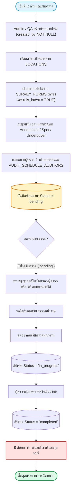
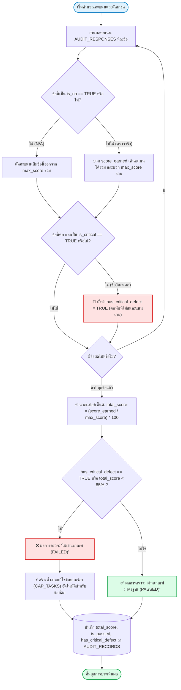
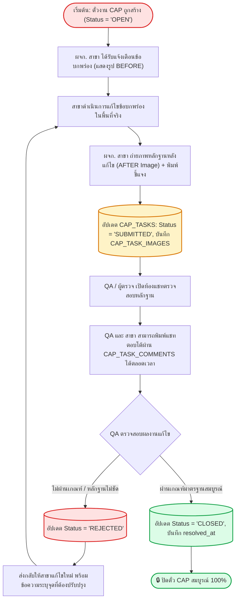
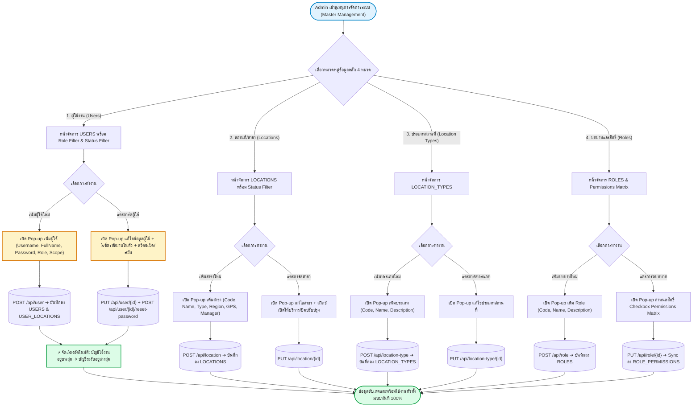

# 📊 Q.S.C. System — ผังกระบวนการทำงานแยกตามเคส (System Flowcharts by Use Case)

> **เวอร์ชัน:** 2.8 (รองรับ Master Data Management 4 หมวด, สวิตช์เลื่อนเปิด/ระงับ, จัดเรียง Active-First, ตัวกรองบทบาท, N/A, ลายเซ็นดิจิทัล, แชท CAP และ กฎข้อวิกฤต)  
> **อัปเดตล่าสุด:** 26 สิงหาคม 2569

---

## 📑 สารบัญแผนภาพผังงาน (Flowcharts)

1. [Case 1: การวางแผนและนัดหมายตรวจ (Audit Scheduling Workflow)](#case-1-การวางแผนและนัดหมายตรวจ-audit-scheduling-workflow)
2. [Case 2: การตรวจสดหน้างาน การลงนาม N/A และ Auto-Sync (Live Audit & Signature Workflow)](#case-2-การตรวจสดหน้างาน-การลงนาม-na-และ-auto-sync-live-audit--signature-workflow)
3. [Case 3: การประเมินคะแนนแบบ Dynamic หัก N/A กฎข้อวิกฤต และเปิดตั๋ว CAP (Fair Scoring & CAP Workflow)](#case-3-การประเมินคะแนนแบบ-dynamic-หัก-na-กฎข้อวิกฤต-และเปิดตั๋ว-cap-fair-scoring--cap-workflow)
4. [Case 4: ลูปการแก้ไขข้อบกพร่องและห้องแชทอนุมัติ CAP (CAP Chat Remediation Workflow)](#case-4-ลูปการแก้ไขข้อบกพร่องและห้องแชทอนุมัติ-cap-cap-chat-remediation-workflow)
5. [Case 5: ศูนย์การจัดการข้อมูลหลักระบบ (Master Data Management & RBAC Workflow)](#case-5-ศูนย์การจัดการข้อมูลหลักระบบ-master-data-management--rbac-workflow)

---

## Case 1: การวางแผนและนัดหมายตรวจ (Audit Scheduling Workflow)
> **ผู้ใช้งาน:** QA Director / Admin / ผู้จัดการทีมตรวจ  
> **ตารางที่เกี่ยวข้อง:** `AUDIT_SCHEDULES`, `AUDIT_SCHEDULE_AUDITORS`, `LOCATIONS`, `SURVEY_FORMS`

---

## Case 2: การตรวจสดหน้างาน การลงนาม N/A และ Auto-Sync (Live Audit & Signature Workflow)
> **ผู้ใช้งาน:** ผู้ตรวจประเมินหน้างาน (Auditor) + ผู้รับการตรวจ (Auditee / Store Manager)  
> **ตารางที่เกี่ยวข้อง:** `AUDIT_DRAFTS`, `AUDIT_RECORDS`, `AUDIT_RESPONSES`, `AUDIT_RESPONSE_IMAGES`

```mermaid
flowchart TD
    StartAudit(["เริ่มต้น: ผู้ตรวจเปิดแอปตรวจหน้างาน"]) --> GPSDistance["อ่านพิกัด GPS บนเครื่องผู้ตรวจเพื่อคำนวณระยะทาง (แสดงสาขาใกล้สุด)"]
    GPSDistance --> BranchList["แสดงรายการสาขา: สาขาตรวจค้างอยู่บนสุด + สาขาอื่นเรียงตามระยะทางใกล้ไปไกล"]
    
    BranchList --> PickBranch["ผู้ตรวจเลือกสาขาที่จะเข้าตรวจ"]
    PickBranch --> LoadDraft{"มีแบบร่างตรวจค้าง (AUDIT_DRAFTS) หรือไม่?"}
    
    LoadDraft -->|"มี"| ResumeDraft["โหลดคำตอบเดิม + รูปภาพ มาทำต่อทันที"]
    LoadDraft -->|"ไม่มี"| CreateDraft["สร้างร่างใหม่: บันทึก StartLatitude, StartLongitude, StartTime"]
    
    ResumeDraft --> Answering["ทำข้อประเมิน (YES/NO, SCALE, TEXT)"]
    CreateDraft --> Answering
    
    Answering --> CheckNA{"ข้อนี้ใช้บังคับกับสาขานี้หรือไม่?"}
    CheckNA -->|"ไม่เกี่ยวข้อง"| MarkNA["🚩 ติ๊ก 'N/A' ➔ ไม่นำข้อนี้ไปคิดเป็นคะแนนเต็ม (Max Score)"]
    CheckNA -->|"ประเมินปกติ"| GradeItem["ให้คะแนนตามความเป็นจริง"]
    
    GradeItem --> CheckFail{"ข้อนี้ได้คะแนนตกหรือไม่?"}
    CheckFail -->|"ตก (Failed)"| UploadPhoto["📸 ถ่ายภาพหลักฐานข้อบกพร่อง (BEFORE Image)"]
    UploadPhoto --> AutoSaveDraft["⚡ Auto-sync บันทึกร่างลง AUDIT_DRAFTS อัตโนมัติ"]
    CheckFail -->|"ผ่าน (Passed)"| AutoSaveDraft
    MarkNA --> AutoSaveDraft
    
    AutoSaveDraft --> CheckFinish{"ตรวจครบทุกข้อหรือยัง?"}
    CheckFinish -->|"ยังไม่ครบ"| Answering
    CheckFinish -->|"ครบแล้ว"| SignPage["เข้าสู่หน้าสรุปผลและลงนามดิจิทัล (Signatures)"]
    
    SignPage --> AuditorSign["ผู้ตรวจลงนามดิจิทัล (Auditor Signature)"]
    AuditorSign --> AuditeeSign["ผู้จัดการสาขาตรวจสอบและลงนามรับทราบ (Auditee Signature)"]
    AuditeeSign --> FinalSubmit["กดยืนยันส่งผลตรวจขั้นสุดท้าย (Final Submit)"]
    
    FinalSubmit --> DBCommit[("บันทึก AUDIT_RECORDS + AUDIT_RESPONSES + AUDIT_RESPONSE_IMAGES")]
    DBCommit --> DelDraft["🗑️ ลบร่างตรวจใน AUDIT_DRAFTS ออก"]
    DelDraft --> UpdateCache["⚡ อัปเดต Cache: last_score และ last_audit_date ในตาราง LOCATIONS"]
    UpdateCache --> EndAudit(["สิ้นสุดกระบวนการตรวจหน้างาน"])

    style StartAudit fill:#e0f2fe,stroke:#0284c7,stroke-width:2px
    style AutoSaveDraft fill:#fef3c7,stroke:#d97706,stroke-width:2px
    style DBCommit fill:#dcfce7,stroke:#16a34a,stroke-width:2px
    style EndAudit fill:#dcfce7,stroke:#16a34a,stroke-width:2px
```

---

## Case 3: การประเมินคะแนนแบบ Dynamic หัก N/A กฎข้อวิกฤต และเปิดตั๋ว CAP (Fair Scoring & CAP Workflow)
> **ผู้ใช้งาน:** ระบบคำนวณอัตโนมัติ (Business Engine)  
> **ตารางที่เกี่ยวข้อง:** `SURVEY_ITEMS`, `AUDIT_RESPONSES`, `AUDIT_RECORDS`, `CAP_TASKS`

---

## Case 4: ลูปการแก้ไขข้อบกพร่องและห้องแชทอนุมัติ CAP (CAP Chat Remediation Workflow)
> **ผู้ใช้งาน:** ผู้จัดการสาขา (Auditee) + ผู้ตรวจสอบมาตรฐาน (QA/QC / Auditor)  
> **ตารางที่เกี่ยวข้อง:** `CAP_TASKS`, `CAP_TASK_IMAGES`, `CAP_TASK_COMMENTS`

---

## Case 5: ศูนย์การจัดการข้อมูลหลักระบบ (Master Data Management & RBAC Workflow)
> **ผู้ใช้งาน:** ผู้ดูแลระบบ (Admin)  
> **ตารางที่เกี่ยวข้อง:** `ROLES`, `PERMISSIONS`, `ROLE_PERMISSIONS`, `USERS`, `USER_LOCATIONS`, `LOCATIONS`, `LOCATION_TYPES`

---
*เอกสารผังงานกระบวนการนี้จัดทำขึ้นเพื่อใช้อ้างอิงการทำงานของทุกเคสในระบบ Q.S.C. System*
