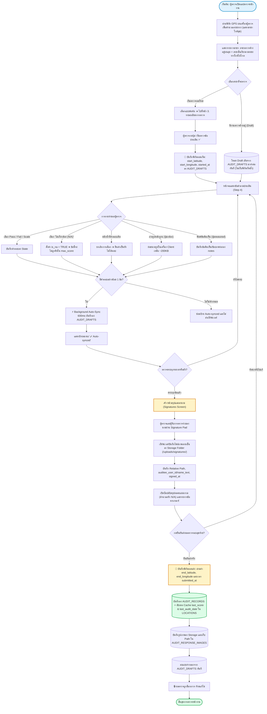
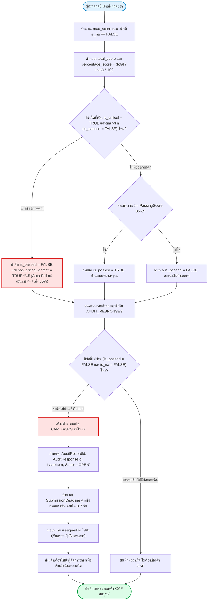
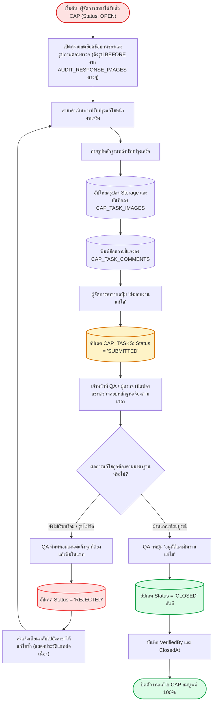
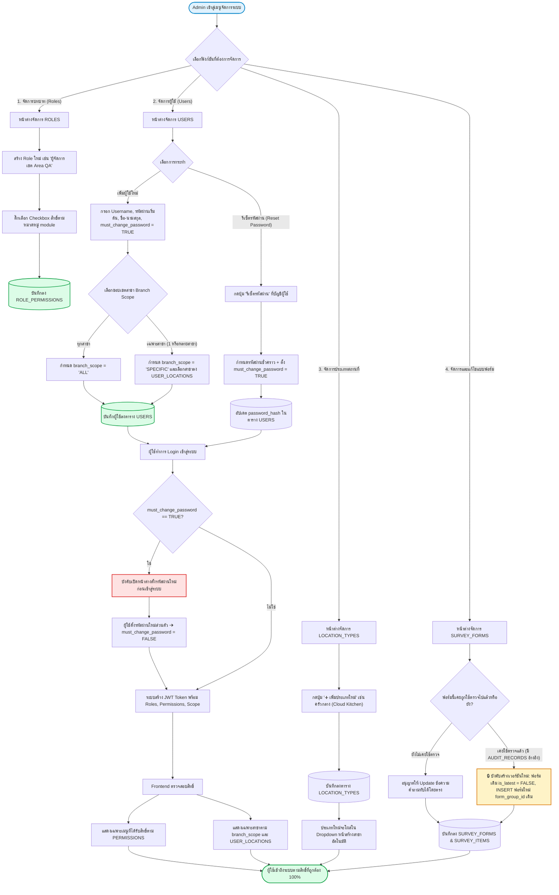

# 📊 Q.S.C. System — ผังกระบวนการทำงานแยกตามเคส (System Flowcharts by Use Case)

> **เวอร์ชัน:** 2.6 (รองรับ N/A, ลายเซ็นและไฟล์ Storage, แชทไทม์ไลน์ CAP, และ กฎข้อวิกฤต)  
> **อัปเดตล่าสุด:** 25 สิงหาคม 2569

---

## 📑 สารบัญแผนภาพผังงาน (Flowcharts)

1. [Case 1: การวางแผนและนัดหมายตรวจ (Audit Scheduling Workflow)](#case-1-การวางแผนและนัดหมายตรวจ-audit-scheduling-workflow)
2. [Case 2: การตรวจสดหน้างาน การลงนาม N/A และ Auto-Sync (Live Audit & Signature Workflow)](#case-2-การตรวจสดหน้างาน-การลงนาม-na-และ-auto-sync-live-audit--signature-workflow)
3. [Case 3: การประเมินคะแนนแบบ Dynamic หัก N/A กฎข้อวิกฤต และเปิดตั๋ว CAP (Fair Scoring & CAP Workflow)](#case-3-การประเมินคะแนนแบบ-dynamic-หัก-na-กฎข้อวิกฤต-และเปิดตั๋ว-cap-fair-scoring--cap-workflow)
4. [Case 4: ลูปการแก้ไขข้อบกพร่องและห้องแชทอนุมัติ CAP (CAP Chat Remediation Workflow)](#case-4-ลูปการแก้ไขข้อบกพร่องและห้องแชทอนุมัติ-cap-cap-chat-remediation-workflow)
5. [Case 5: การจัดการสิทธิ์ รีเซ็ตรหัสผ่าน และประเภทสถานที่ของ Admin (Admin Management Workflow)](#case-5-การจัดการสิทธิ์-รีเซ็ตรหัสผ่าน-และประเภทสถานที่ของ-admin-admin-management-workflow)

---

## Case 1: การวางแผนและนัดหมายตรวจ (Audit Scheduling Workflow)
> **ผู้ใช้งาน:** QA Director / Admin / ผู้จัดการทีมตรวจ  
> **ตารางที่เกี่ยวข้อง:** `AUDIT_SCHEDULES`, `AUDIT_SCHEDULE_AUDITORS`, `LOCATIONS`, `SURVEY_FORMS`

---

## Case 2: การตรวจสดหน้างาน การลงนาม N/A และ Auto-Sync (Live Audit & Signature Workflow)
> **ผู้ใช้งาน:** ผู้ตรวจประเมินหน้างาน (Auditor) + ผู้รับการตรวจ (Auditee / Store Manager)  
> **ตารางที่เกี่ยวข้อง:** `AUDIT_DRAFTS`, `AUDIT_RECORDS`, `AUDIT_RESPONSES`, `AUDIT_RESPONSE_IMAGES`

---

## Case 3: การประเมินคะแนนแบบ Dynamic หัก N/A กฎข้อวิกฤต และเปิดตั๋ว CAP (Fair Scoring & CAP Workflow)
> **ผู้ใช้งาน:** ระบบอัตโนมัติ (Backend Business Logic)  
> **ตารางที่เกี่ยวข้อง:** `AUDIT_RECORDS`, `AUDIT_RESPONSES`, `SURVEY_ITEMS`, `CAP_TASKS`

---

## Case 4: ลูปการแก้ไขข้อบกพร่องและห้องแชทอนุมัติ CAP (CAP Chat Remediation Workflow)
> **ผู้ใช้งาน:** ผู้จัดการสาขา (Auditee) ➔ เจ้าหน้าที่ QA / Auditor  
> **ตารางที่เกี่ยวข้อง:** `CAP_TASKS`, `CAP_TASK_IMAGES`, `CAP_TASK_COMMENTS`, `AUDIT_RESPONSE_IMAGES`

---

## Case 5: การจัดการสิทธิ์ รีเซ็ตรหัสผ่าน และประเภทสถานที่ของ Admin (Admin Management Workflow)
> **ผู้ใช้งาน:** ผู้ดูแลระบบ (Admin)  
> **ตารางที่เกี่ยวข้อง:** `ROLES`, `PERMISSIONS`, `ROLE_PERMISSIONS`, `USERS`, `USER_LOCATIONS`, `LOCATIONS`, `LOCATION_TYPES`, `SURVEY_FORMS`

---
*เอกสารผังงานกระบวนการนี้จัดทำขึ้นเพื่อใช้อ้างอิงการทำงานของทุกเคสในระบบ Q.S.C. System*
