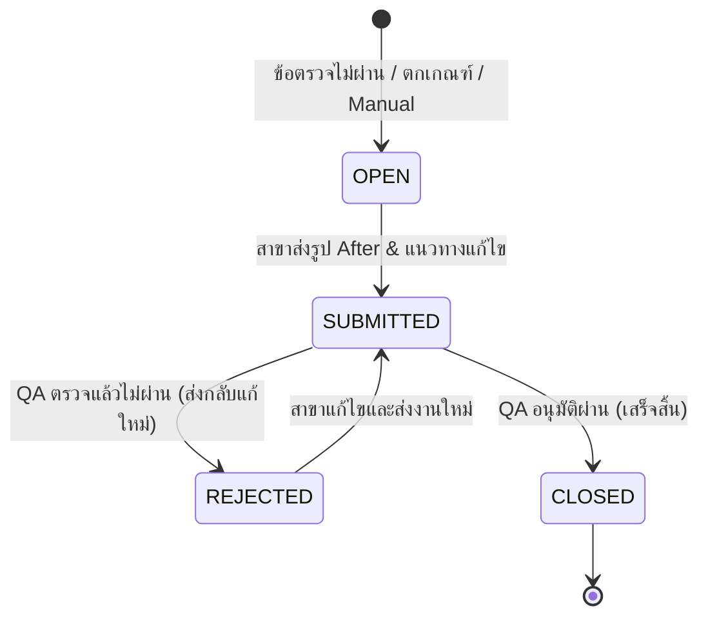

# 📖 QSC System — เอกสารข้อกำหนดมาตรฐานระบบ (System Specification & Conventions)

> **ฉบับมาตรฐาน:** Single Source of Truth for QSC System Architecture & Conventions  
> **อัปเดตล่าสุด:** ตุลาคม 2569  
> **สถานะ:** Active Standard (มีผลบังคับใช้ทุกส่วนงานของระบบ)  
> 
> ⚠️ **คำสั่งสำคัญสำหรับนักพัฒนา (Mandatory Rule for Developers):**  
> 1. ก่อนลงมือเขียนโค้ด พัฒนาหน้าจอใหม่ หรือขยายฟีเจอร์ใด ๆ **ต้องอ่านเอกสารนี้ให้เข้าใจก่อนเสมอ**  
> 2. ทุกการพัฒนาต้องยึดถือชื่อรหัส (`Code`), ชื่อหมวด (`Name`), และประเภทข้อมูล (`Type`) ตามมาตรฐานในเอกสารนี้ ห้ามตั้งชื่อเองตามใจชอบจนระบบเกิดความสับสนหรือผิดเพี้ยน  
> 3. หากมีความจำเป็นต้องเพิ่มประเภทข้อมูลใหม่, เพิ่มรหัสใหม่, หรือปรับปรุงเงื่อนไขทางธุรกิจ **ต้องอัปเดตเอกสาร `SYSTEM_SPEC.md` ฉบับนี้ให้สอดคล้องกันทุกครั้ง**

---

## 📑 สารบัญ (Table of Contents)
1. [มาตรฐานหมวดหมู่และการคิดคะแนน (Category & Scoring Standards)](#1-มาตรฐานหมวดหมู่และการคิดคะแนน-category--scoring-standards)
2. [มาตรฐานประเภทข้อตรวจและฟิลด์ข้อมูล (Question & Field Types)](#2-มาตรฐานประเภทข้อตรวจและฟิลด์ข้อมูล-question--field-types)
3. [กฎเหล็กการจับคู่แบบฟอร์มและเวอร์ชัน (Strict ID Matching Rule)](#3-กฎเหล็กการจับคู่แบบฟอร์มและเวอร์ชัน-strict-id-matching-rule)
4. [มาตรฐานการคิดคะแนนและความถูกต้อง (Fair Scoring Engine)](#4-มาตรฐานการคิดคะแนนและความถูกต้อง-fair-scoring-engine)
5. [มาตรฐานหน้าจอและระบบแก้ไขผลตรวจ (Audit Inline Editing & Audit Trail)](#5-มาตรฐานหน้าจอและระบบแก้ไขผลตรวจ-audit-inline-editing--audit-trail)
6. [มาตรฐานงานแก้ไขข้อบกพร่อง (CAP - Corrective Action Plan)](#6-มาตรฐานงานแก้ไขข้อบกพร่อง-cap---corrective-action-plan)
7. [มาตรฐานการจัดการพิกัดและระยะทาง (Location & GPS Standards)](#7-มาตรฐานการจัดการพิกัดและระยะทาง-location--gps-standards)
8. [มาตรฐานบทบาทและสิทธิ์ผู้ใช้งาน (Roles & RBAC Standards)](#8-มาตรฐานบทบาทและสิทธิ์ผู้ใช้งาน-roles--rbac-standards)
9. [มาตรฐานสถาปัตยกรรมและโครงสร้างไฟล์ (Tech Stack & Storage Standards)](#9-มาตรฐานสถาปัตยกรรมและโครงสร้างไฟล์-tech-stack--storage-standards)
10. [Checklist สำหรับการพัฒนาฟีเจอร์ใหม่ (Developer Checklist)](#10-checklist-สำหรับการพัฒนาฟีเจอร์ใหม่-developer-checklist)

---

## 1. มาตรฐานหมวดหมู่และการคิดคะแนน (Category & Scoring Standards)

ในการจัดโครงสร้างข้อตรวจ (Sections) ของแบบฟอร์ม ระบบ QSC ได้จำแนกหมวดหมู่ออกเป็น 2 กลุ่มอย่างชัดเจน:

### 1.1 หมวดข้อมูลทั่วไปที่ไม่คิดคะแนน (Non-scored / Information Section) 🌟
ใช้สำหรับเก็บข้อมูลประกอบรอบการตรวจ เช่น จำนวนพนักงานในร้าน, ข้อมูลกะการทำงาน, อุณหภูมิแวดล้อม, เวลาเข้าตรวจ, ข้อมูลเสริม หรือผู้ร่วมสังเกตการณ์

| ฟิลด์ / ตัวแปร | ค่ามาตรฐานที่ต้องใช้ | คำอธิบาย |
| :--- | :--- | :--- |
| **CategoryCode** | **`INFO`** | รหัสมาตรฐานสากลของระบบ ใช้ในทุกโมดูลทั้ง Backend, Frontend, API, และรายงาน |
| **CategoryName** | **`รายละเอียด`** | ชื่อหมวดภาษาไทยที่ใช้แสดงผล (รองรับชื่อสำรอง: `ข้อมูลทั่วไป`) |
| **isScored** | **`false`** | ระบุชัดเจนว่าหมวดนี้ไม่คิดคะแนน |
| **sectionType** | **`INFO`** | กำหนดประเภท Section เป็น INFO เพื่อให้ตัวประเมินแยกแยะออก |

> 🚫 **ข้อห้ามเด็ดขาดสำหรับหมวด `INFO`:**
> - **ห้าม** นำคำถามในหมวด `INFO` ไปรวมในคะแนนเต็ม (`max_score`)
> - **ห้าม** นำคำตอบในหมวด `INFO` ไปคิดเป็นคะแนนที่ได้ (`total_score`)
> - **ห้าม** นำหมวด `INFO` ไปคิดในเกณฑ์การผ่าน/ไม่ผ่านของสาขา
> - **ห้าม** ใช้รหัสอื่น เช่น `OTHER`, `DETAIL`, `MISC` ให้ใช้ **`INFO`** เท่านั้น

---

### 1.2 หมวดคิดคะแนนหลัก (Core Scored Categories) 🎯
หมวดการตรวจวัดคุณภาพ 5 เสาหลักตามมาตรฐาน QSC:

| รหัสมาตรฐาน (`CategoryCode`) | รหัสเดิม/สำรอง (`Legacy Code`) | ชื่อภาษาไทย (`CategoryName`) | ชื่อภาษาอังกฤษ | ขอบเขตการประเมิน |
| :---: | :---: | :--- | :--- | :--- |
| **`PD`** | `QLT` | **คุณภาพสินค้า** | Product | รสชาติ, หน้าตาอาหาร, อุณหภูมิสินค้า, วัตถุดิบ, วันหมดอายุ (FIFO) |
| **`PC`** | `OPS` | **กระบวนการปฏิบัติงาน** | Process | ขั้นตอนการผลิต, การทำงานเครื่องจักร, สุขลักษณะ GMP, มาตรการความปลอดภัย |
| **`S`** | `SVC` | **การบริการ** | Service | การต้อนรับ, ความสุภาพ, ความรวดเร็ว, การแต่งกายของพนักงาน |
| **`C`** | `CLN` | **ความสะอาด** | Cleanliness | ความสะอาดพื้นที่บริการ, สุขา, ครัว, ถังขยะ, การควบคุมแมลงพาหะ |
| **`DM`** | `DOC` | **งานเอกสาร** | Documents | สมุดบันทึกอุณหภูมิ, รายการตรวจเช็คประจำวัน, ใบอนุญาต, เอกสารฝึกอบรม |

> 💡 **ฟังก์ชันจัดกลุ่มหมวดหมู่อ้างอิง:** [`frontend/src/screens/audit/AuditHistoryDetail.jsx`](frontend/src/screens/audit/AuditHistoryDetail.jsx) ฟังก์ชัน `getNormalizedCategory()` และ [`frontend/src/config/scoring.js`](frontend/src/config/scoring.js)

---

## 2. มาตรฐานประเภทข้อตรวจและฟิลด์ข้อมูล (Question & Field Types)

### 2.1 ข้อตรวจแบบคิดคะแนน (Audit Scored Item Types) 🎯
> ⚡ **ระบบ QSC กำหนดให้มีเพียง 2 ประเภทเท่านั้นที่นำมาคิดคะแนน (Scored Types):**
> (อ้างอิง `backend/QSC.Api/Services/SectionRules.cs` และ `frontend/src/config/scoring.js`)

| ประเภท (`QuestionType`) | คำอธิบาย | เกณฑ์คะแนน | การคิดสถานะผ่าน | การเปิดงาน CAP |
| :--- | :--- | :--- | :--- | :--- |
| **`YESNO`** | ผ่าน / ไม่ผ่าน / ข้าม (N/A) | ผ่าน = เต็ม (`FullScore`), ไม่ผ่าน = 0 | ตอบ `true` หรือ `is_na = true` | เปิด CAP อัตโนมัติเมื่อตอบ `false` |
| **`SCALE`** | ระดับคะแนน (เช่น 1–5 หรือ 1–10) | ให้คะแนนตามระดับที่เลือก (สูตร: `(scaleVal / 5) * FullScore`) | คะแนน $\ge 3$ (กรณี 1–5) หรือตามเกณฑ์ | เปิด CAP อัตโนมัติเมื่อคะแนนตกเกณฑ์ |

---

### 2.2 ประเภทข้อตรวจและฟิลด์ข้อมูลที่ไม่คิดคะแนน (Non-scored Item & Field Types) 📋
> 🚫 **ข้อตรวจและฟิลด์ข้อมูลในกลุ่มนี้ทั้งหมด "ไม่คิดคะแนน" (`isScored = false`):**  
> ไม่นำคะแนนไปรวมใน `max_score` และ `total_score` ใช้สำหรับบันทึกข้อมูลประกอบ ข้อสังเกต หรือตารางประเมินเสริม

| ประเภท (`Type` / `QuestionType`) | การทำงานและ UI | ตัวอย่างการใช้งาน |
| :--- | :--- | :--- |
| **`MULTI_ANS`** (`multians`) 🌟 | **แบบประเมินหลายเงื่อนไข/ตัวเลือก (ไม่คิดคะแนน)** — ใช้บันทึกข้อตรวจที่มีหลายข้อย่อยหรือมีตัวเลือกเงื่อนไขผสม โดยไม่นำคะแนนไปรวมกับคะแนนรวมของสาขา | แบบประเมินพฤติกรรมการบริการหลายมิติ, รายการเช็คลิสต์ตรวจสภาพร้านย่อย |
| **`GRID`** (`grid`) | **ตารางประเมินประเด็นย่อย (ไม่คิดคะแนน)** | ตารางตรวจเช็คความสะอาดแต่ละจุดย่อย, ตารางบันทึกอุณหภูมิตู้เย็นหลายตู้ |
| **`text`** | ช่องกรอกข้อความสั้น | ชื่อผู้จัดการสาขา, รหัสกะ, หมายเหตุพิเศษ |
| **`number`** | ช่องกรอกตัวเลข | จำนวนพนักงานประจำกะ (`staff_count`), อุณหภูมิหน้าร้าน |
| **`select`** | Dropdown เลือกค่าได้ 1 ค่า | สภาพอากาศ, ช่วงเวลาการตรวจ (เช้า/บ่าย/ค่ำ) |
| **`radio`** | ตัวเลือกแบบ Radio Button | ประเภทการตรวจ (ปกติ, ตรวจซ้ำ, สุ่มตรวจ) |
| **`checkbox`** | กล่องเลือกตอบได้หลายตัวเลือก | อุปกรณ์ที่มีการเปิดใช้งาน |
| **`date`** | ตัวเลือกวันที่ (Date Picker: YYYY-MM-DD) | วันที่เริ่มรอบตรวจจริง |
| **`time`** | ตัวเลือกเวลา (Time Picker: HH:mm) | เวลาที่เริ่มและสิ้นสุด |
| **`auditor`** | ตัวเลือกผู้ตรวจ (ผูกกับบัญชีผู้ใช้) | ผู้ร่วมตรวจสังเกตการณ์ |
| **`signature`** | ลายเซ็นดิจิทัล Canvas | ลายเซ็นผู้จัดการสาขา, ลายเซ็นผู้ตรวจ |

---

## 3. กฎเหล็กการจับคู่แบบฟอร์มและเวอร์ชัน (Strict ID Matching Rule)

> [!CAUTION]
> ### 🚨 กฎเหล็ก: ห้ามจับคู่แบบฟอร์มด้วยชื่อ (Title / Name Matching) โดยเด็ดขาด!
> เมื่อแบบฟอร์มมีการแก้ไขและโคลนเวอร์ชันใหม่ (เช่น Version 1 -> Version 2):
> - **ต้องจับคู่ด้วย `id` หรือ `surveyFormId` (Strict ID Matching) เท่านั้น**
> - **ห้าม** นำชื่อฟอร์มภาษาไทยหรืออังกฤษไปใช้ `find(f => f.title === record.formTitle)` ข้ามเวอร์ชันเด็ดขาด
> - **เหตุผล:** ในเวอร์ชันใหม่อาจมีการเพิ่ม/ลบข้อตรวจ หรือเปลี่ยนน้ำหนักคะแนน หากนำประวัติเก่าไปผูกกับฟอร์มเวอร์ชันใหม่ จะทำให้ข้อตรวจและสถิติคลาดเคลื่อนทันที

**รูปแบบโค้ดที่ถูกต้อง:**
```javascript
// ✅ ถูกต้อง: จับคู่ด้วย ID เท่านั้น
const matchedForm = useMemo(() => {
  const targetId = currentRecord?.surveyFormId || currentRecord?.formId;
  if (!targetId) return null;
  return forms.find(f => Number(f.id) === Number(targetId)) || null;
}, [forms, currentRecord?.surveyFormId, currentRecord?.formId]);
```

---

## 4. มาตรฐานการคิดคะแนนและความถูกต้อง (Fair Scoring Engine)

### 4.1 สูตรการคำนวณคะแนนอย่างเป็นธรรม (Fair Dynamic Scoring Formula)
1. **การยกเว้นข้อ N/A (Not Applicable):**
   - ข้อใดที่ผู้ตรวจทำเครื่องหมายว่า **"ข้าม / ไม่เกี่ยวข้อง" (`isNa = true`)** จะต้องถูกหักออกจากคะแนนเต็ม (`max_score`) ของหมวดหมู่นั้นและของระบบ
   - ข้อ N/A จะไม่ถูกนำมาคิดเป็นข้อตก
2. **การยกเว้นหมวด `INFO`:**
   - ข้อตรวจในหมวด `INFO` หรือข้อที่มี `isScored = false` จะไม่ถูกนำมารวมใน `total_score` และ `max_score`
3. **สูตรคิดเปอร์เซ็นต์คะแนน:**
   $$\text{PercentageScore} = \left(\frac{\sum \text{ScoreGiven}}{\sum \text{MaxScore (Scored \& non-NA)}}\right) \times 100$$
   - บันทึกและแสดงผลด้วย **ทศนิยม 2 ตำแหน่ง** (เช่น `85.50%`)

### 4.2 กฎข้อบกพร่องวิกฤต (Critical Defect Rule) ⚠️
- ข้อตรวจใดที่ระบุ `isCritical = true` หากประเมินแล้ว **"ไม่ผ่าน" (`isPassed = false` หรือ `scoreGiven == 0`)**
- ระบบจะปรับสถานะรอบตรวจเป็น **`hasCriticalDefect = true`**
- **ผลการตัดสินรอบตรวจนั้นจะ "ไม่ผ่าน" (FAIL) ทันที 100%** ไม่ว่าคะแนนรวมเฉลี่ยจะได้สูงเท่าใดก็ตาม!

---

## 5. มาตรฐานหน้าจอและระบบแก้ไขผลตรวจ (Audit Inline Editing & Audit Trail)

หน้าตรวจสอบประวัติผลตรวจ ([AuditHistoryDetail.jsx](frontend/src/screens/audit/AuditHistoryDetail.jsx)) ได้รับการออกแบบให้รองรับ **Inline Editing (แก้ไขบนหน้าจอได้ทันทีโดยไม่ต้องเปิดป๊อปอัป modal แยก)**

### 5.1 การแสดงผลและแอนิเมชันนำทาง
- **ปุ่มแก้ไข:** ปุ่ม "แก้ไขผลตรวจ" อยู่ที่ Top Header และมี Floating Bottom Action Bar ด้านล่าง
- **Speech Bubble Badge:** เมื่ออยู่ในโหมดแก้ไข แท็บที่สามารถแก้ไขได้จะแสดงกล่องคำพูดสีเขียวมรกตพร้อมไอคอนดินสอ (`Edit3`) เด้งกระดอนนุ่มนวล (`animate-bounce`):
  - `overview` (คะแนน)
  - `responses` (ผลตรวจ)
  - `sign` (สรุป&ลงชื่อ)
  - `location` (ตำแหน่ง)
  - *แท็บประวัติการแก้ไขและ CAP จะไม่มีไอคอนนี้*

### 5.2 การแก้ไขตามแต่ละแท็บ
1. **แท็บ `overview` (คะแนน & ข้อมูลรอบการตรวจ):**
   - ฟิลด์ตัวเลือก (รอบตรวจ, ผู้ตรวจ, metadata ประเภท select) แสดงผลเป็น `<select>` Dropdown พอดีช่อง
   - ฟิลด์ข้อความ/ตัวเลข (จำนวนพนักงาน `staff_count`) แสดงเป็น Input ขนาดกะทัดรัดพร้อมไอคอนดินสอด้านขวา
2. **แท็บ `responses` (ผลตรวจรายข้อ):**
   - ตัวเลือก ผ่าน / ไม่ผ่าน / ข้าม และ ระดับคะแนน 1–5 **ไม่เป็นสีเทา** และคลิกเปลี่ยนคำตอบได้ทันที
   - มุมบนขวามีปุ่ม **หมายเหตุ (`MessageSquare`)** และปุ่ม **รูปภาพ (`Camera`)**
   - **กฎบังคับระบุเหตุผล:** หากข้อใดมีการเปลี่ยนคะแนนจากเดิม ระบบจะบังคับให้กรอก **"เหตุผลในการแก้ไขคะแนน" (`editReason`)**
   - คะแนนรวมและแถบสถิติแต่ละหมวดหมู่อัปเดตแบบเรียลไทม์ทันทีที่คลิก
3. **แท็บ `sign` (สรุปและลงชื่อ):**
   - ข้อเสนอแนะภาพรวมแก้ไขได้ผ่าน `<textarea>`
   - ชื่อตัวแทนสาขาแก้ไขได้
   - ลายเซ็นดิจิทัลมีปุ่ม "แก้ไขลายเซ็น" เปิดวาดใหม่ผ่าน [SignaturePadModal.jsx](frontend/src/modals/SignaturePadModal.jsx)
4. **แท็บ `location` (ตำแหน่ง):**
   - มีช่องกรอก ละติจูด (Latitude) และ ลองติจูด (Longitude) ใต้แผนที่ทั้ง 2 จุด
   - มีปุ่ม "ดึงพิกัด GPS ปัจจุบัน" และปุ่ม "ล้างพิกัด"
   - ตัวอย่างแผนที่ iframe และลิงก์ Google Maps อัปเดตพิกัดตามทันที

### 5.3 มาตรฐานการบันทึกประวัติ (Audit Trail & Concurrency)
- ก่อนบันทึก ระบบจะแสดงป๊อปอัปให้ระบุ **"เหตุผลการแก้ไขรอบการตรวจ (Overall Reason)"**
- ส่ง `version` ไปกับ Payload ทุกครั้งเพื่อทำ Optimistic Concurrency Control
- Backend บันทึกลงตาราง `AUDIT_EDIT_LOGS` เก็บประวัติ: ใครแก้, แก้เมื่อใด, เหตุผลคืออะไร, ค่าเดิมคืออะไร, ค่าใหม่คืออะไร

---

## 6. มาตรฐานงานแก้ไขข้อบกพร่อง (CAP - Corrective Action Plan)

### 6.1 สถานะวงจรชีวิตของ CAP (CAP Lifecycle Statuses)


| สถานะ (`Status`) | ความหมาย | สิทธิ์ในการเปลี่ยน |
| :---: | :--- | :--- |
| **`OPEN`** | งานเปิดใหม่ รอสาขาดำเนินการ | ระบบสร้างอัตโนมัติ หรือ Auditor เปิด |
| **`SUBMITTED`** | สาขาส่งงานแก้ไขพร้อมรูปหลักฐานแล้ว | ผู้จัดการสาขา (`AUDITEE`) |
| **`REJECTED`** | ตีกลับงานแก้ไข (ต้องระบุเหตุผล) | ผู้ตรวจประเมิน (`AUDITOR`) หรือ QA |
| **`CLOSED`** | ปิดงานเรียบร้อย มาตรฐานผ่านเกณฑ์ | ผู้ตรวจประเมิน (`AUDITOR`) หรือ Admin |

### 6.2 การสื่อสารแบบ Real-time
- ห้องแชทงาน CAP รองรับการส่งข้อความและรูปภาพแบบเรียลไทม์ผ่าน **SignalR WebSockets** (`/hubs/cap-chat`)
- ระบบเก็บรูปภาพแยกเป็น 2 ชุดชัดเจน: **`BEFORE`** (รูปตอนตรวจหน้างาน) และ **`AFTER`** (รูปหลังปรับปรุงเสร็จ)

### 6.3 มาตรฐานการจัดการ CAP เมื่อมีการแก้ไขผลตรวจ (Smart CAP Handling Policy)
เมื่อผู้ตรวจหรือ Admin แก้ไขผลตรวจย้อนหลังในหน้า [AuditHistoryDetail.jsx](frontend/src/screens/audit/AuditHistoryDetail.jsx):
1. **เมื่อข้อตรวจเปลี่ยนจาก "ไม่ผ่าน" เป็น "ผ่าน" หรือ "ข้าม (N/A)":**
   - **กรณีไม่มีประวัติการใช้งานจริง (Untouched):** หากงาน CAP นั้นยังไม่มีผู้ใช้งานส่งข้อความแชท (ยกเว้นข้อความระบบตอนเปิดงาน) และยังไม่มีการแนบรูปภาพหลักฐาน `AFTER` $\rightarrow$ ระบบจะ **ลบงาน CAP นั้นทิ้งอย่างถาวร (Hard Delete)** ทันที เพื่อไม่ให้เกิดขยะข้อมูลในระบบและสาขาไม่สับสน
   - **กรณีมีประวัติการพูดคุยหรือส่งหลักฐานแล้ว (Engaged):** มีการส่งแชทหรือรูปภาพหลักฐานแล้ว $\rightarrow$ ระบบจะ **ไม่ลบข้อมูลทิ้ง** เพื่อรักษา Audit Trail แต่จะปรับสถานะของงานเป็น **`CANCELLED`** พร้อมบันทึกข้อความระบบระบุสาเหตุการยกเลิก
2. **เมื่อข้อตรวจเปลี่ยนจาก "ผ่าน" เป็น "ไม่ผ่าน":**
   - ระบบจะสร้างงาน CAP ใหม่ในสถานะ `OPEN` ทันที
3. **เมื่อข้อตรวจเดิมไม่ผ่าน และยังคงไม่ผ่านเหมือนเดิม:**
   - ระบบจะ **ไม่สร้างงาน CAP ซ้ำซ้อน** ในการบันทึกแต่ละครั้ง

---

## 7. มาตรฐานการจัดการพิกัดและระยะทาง (Location & GPS Standards)

| คุณสมบัติ | มาตรฐานที่กำหนด |
| :--- | :--- |
| **ฟิลด์พิกัด** | `Latitude` และ `Longitude` (ชนิดข้อมูล: `decimal(10, 7)` หรือ `double`) |
| **ช่วงค่าที่ถูกต้อง** | ละติจูด: $-90.0$ ถึง $90.0$, ลองติจูด: $-180.0$ ถึง $180.0$ |
| **สูตรคำนวณระยะห่าง** | ใช้สูตร **Haversine Formula** บน Client & Backend เพื่อคำนวณระยะห่างจากสาขาเป็นเมตร |
| **รัศมีการตรวจที่ยอมรับ** | แนะนำ $\le 500$ เมตรจากพิกัดสาขา หากเกินระยะระบบจะแจ้งเตือนผู้ตรวจ |

---

## 8. มาตรฐานบทบาทและสิทธิ์ผู้ใช้งาน (Roles & RBAC Standards)

### 8.1 รหัสบทบาทมาตรฐาน (Role Codes)
1. **`ADMIN`** — ผู้ดูแลระบบสูงสุด: เข้าถึงได้ทุกเมนู, จัดการ Master Data, ปรับแต่งแถบนำทาง, จัดการสิทธิ์
2. **`AUDITOR`** — ผู้ตรวจประเมิน: วางแผนตรวจ, ทำการตรวจสด, แก้ไขผลตรวจ (หากมีสิทธิ์ `audit.edit`), ตรวจรับงาน CAP
3. **`AUDITEE`** — ผู้จัดการสาขา/ผู้รับตรวจ: ดูผลตรวจสาขาตนเอง, เซ็นรับทราบ, ส่งรูปและแชทแก้ไขงาน CAP
4. **`STANDARD`** — เจ้าหน้าที่มาตรฐาน/QA Coordinator: จัดการแบบฟอร์ม, วิเคราะห์สถิติ, อนุมัติงาน CAP
5. **`EXEC`** — ผู้บริหาร: ดูแดชบอร์ดภาพรวม, วิเคราะห์ Trend รายสาขา/แบรนด์, ส่งออกรายงาน Excel

### 8.2 การจำกัดขอบเขตการเข้าถึง (Scoped Access Standards)
- **`BranchScope`**:
  - `'ALL'` = เข้าถึงได้ทุกสาขาในระบบ
  - `'SPECIFIC'` = เข้าถึงได้เฉพาะสาขาที่มีบันทึกในตาราง `USER_LOCATIONS`
- **`BrandScope`**:
  - `'ALL'` = เข้าถึงได้ทุกแบรนด์ในเครือ
  - `'SPECIFIC'` = เข้าถึงได้เฉพาะแบรนด์ที่มีบันทึกในตาราง `USER_BRANDS`

---

## 9. มาตรฐานสถาปัตยกรรมและโครงสร้างไฟล์ (Tech Stack & Storage Standards)

### 9.1 เทคโนโลยีหลักของระบบ
- **Frontend:** React 19 + Vite 8 + Tailwind CSS v4 (Emerald Corporate `#0F6659`) + Lucide Icons + Recharts + Leaflet
- **Backend:** ASP.NET Core Web API (C# .NET) + Entity Framework Core + SignalR
- **Database:** Microsoft SQL Server (`QSCDB`) / Code-first migration

### 9.2 มาตรฐานโฟลเดอร์จัดเก็บรูปภาพ (File Storage Hierarchy)
อ้างอิงตาม [`GUIDE.md`](GUIDE.md):
```text
uploads/
└── {YYYY-MM-DD}/                             <-- วันที่อัปโหลด
    └── {โฟลเดอร์ระบุงาน}/                      <-- เช่น audit_s15_BKK01 หรือ audit_BKK02
        ├── audits/                           <-- รูปหลักฐานข้อตรวจ (Before)
        ├── cap/                              <-- รูปหลักฐานงานแก้ไข (After)
        └── signatures/                       <-- ลายเซ็นดิจิทัล
```
- **ขนาดและนามสกุล:** บีบอัดภาพผ่าน HTML5 Canvas บน Frontend เหลือขนาด $\le 200\text{--}300$ KB ในรูปแบบ `.webp` หรือ `.jpeg` ก่อนส่งขึ้น Server เสมอ

---

## 10. Checklist สำหรับการพัฒนาฟีเจอร์ใหม่ (Developer Checklist)

ก่อนเปิด Pull Request หรือ Deploy ฟีเจอร์ใหม่ ให้ตรวจสอบตามรายการด้านล่าง:

- [ ] **หมวด `INFO`:** หากเป็นข้อมูลทั่วไป ได้ตั้ง `CategoryCode = "INFO"`, `CategoryName = "รายละเอียด"`, และ `isScored = false` หรือไม่?
- [ ] **ประเภทข้อตรวจที่คิดคะแนน:** ข้อตรวจที่นำมาคิดคะแนนมีเฉพาะ **`YESNO`** และ **`SCALE`** เท่านั้นหรือไม่? (ประเภท **`MULTI_ANS`**, **`GRID`**, **`text`**, **`number`** ฯลฯ ต้องไม่นำมาคิดคะแนน / `isScored = false`)
- [ ] **การจับคู่ฟอร์ม:** ได้จับคู่ฟอร์มด้วย `id` หรือ `surveyFormId` ตรงกันเป๊ะ (ไม่ใช่จับคู่ด้วยชื่อ) หรือไม่?
- [ ] **การคิดคะแนน:** ข้อ N/A ถูกหักออกจากคะแนนเต็มหรือไม่? และหากมีข้อ Critical ตก ได้ตัดสินให้ไม่ผ่านทันทีหรือไม่?
- [ ] **การแก้ไขผลตรวจ:** หากมีการเปลี่ยนคะแนน ได้บังคับให้ระบุ `editReason` หรือไม่?
- [ ] **UI & Styling:** ปฏิบัติตาม Fresh Mint / Emerald Palette (`#0F6659`) และใช้ Tailwind คลาสที่ถูกต้องหรือไม่?
- [ ] **การทดสอบ Build:** ฝั่ง Frontend รัน `npm run build` ผ่าน 0 errors และ Backend รัน `dotnet build -t:Compile` ผ่าน 0 errors หรือไม่?
- [ ] **การปรับปรุง Spec:** หากมีประเภทคำถามใหม่, รหัสหมวดใหม่, หรือเงื่อนไขใหม่ ได้มาเพิ่มในเอกสาร `SYSTEM_SPEC.md` นี้แล้วหรือยัง?

---

*เอกสารฉบับนี้ดูแลและปรับปรุงโดยทีมพัฒนาระบบ QSC System — หากมีข้อสงสัยหรือต้องการเสนอปรับมาตรฐาน ให้ประสานงานร่วมกับทีมพัฒนาก่อนเสมอ*
