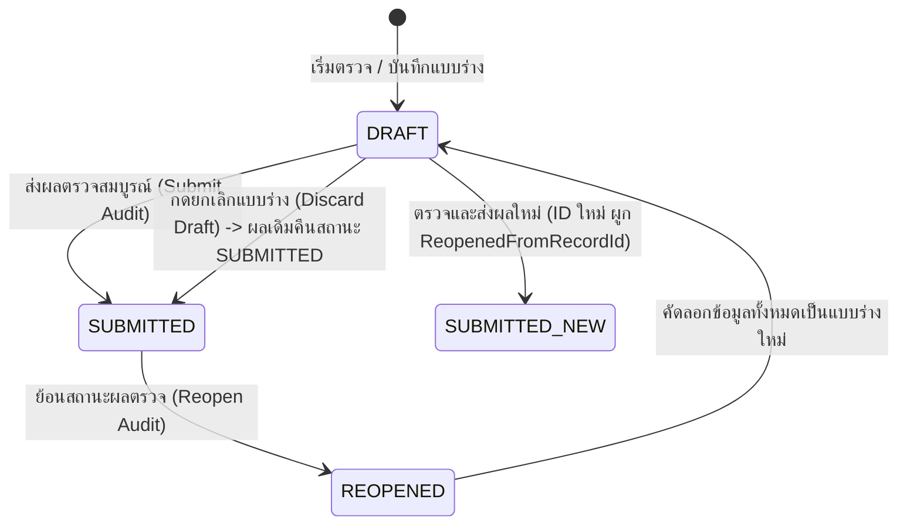
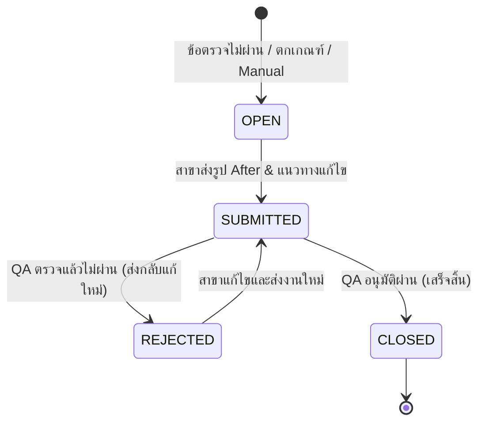

# 📖 QSC System — เอกสารข้อกำหนดมาตรฐานระบบ (System Specification & Conventions)

> **ฉบับมาตรฐาน:** Single Source of Truth for QSC System Architecture & Conventions  
> **อัปเดตล่าสุด:** ตุลาคม 2569  
> **สถานะ:** Active Standard (มีผลบังคับใช้ทุกส่วนงานของระบบ)  
> 
> ⚠️ **คำสั่งสำคัญสำหรับนักพัฒนา (Mandatory Rule for Developers):**  
> 1. ก่อนลงมือเขียนโค้ด พัฒนาหน้าจอใหม่ หรือขยายฟีเจอร์ใด ๆ **ต้องอ่านเอกสารนี้ให้เข้าใจก่อนเสมอ**  
> 2. ทุกการพัฒนาต้องยึดถือชื่อรหัส (`Code`), ชื่อหมวด (`Name`), และประเภทข้อมูล (`Type`) ตามมาตรฐานในเอกสารนี้ ห้ามตั้งชื่อเองตามใจชอบจนระบบเกิดความสับสนหรือผิดเพี้ยน  
> 3. หากมีความจำเป็นต้องเพิ่มประเภทข้อมูลใหม่, เพิ่มรหัสใหม่, หรือปรับปรุงเงื่อนไขทางธุรกิจ **ต้องอัปเดตเอกสาร `SYSTEM_SPEC.md` ฉบับนี้ให้สอดคล้องกันทุกครั้ง**

---

## 📑 สารบัญ (Table of Contents)
1. [มาตรฐานหมวดหมู่และการคิดคะแนน (Category & Scoring Standards)](#1-มาตรฐานหมวดหมู่และการคิดคะแนน-category--scoring-standards)
2. [มาตรฐานประเภทข้อตรวจและฟิลด์ข้อมูล (Question & Field Types)](#2-มาตรฐานประเภทข้อตรวจและฟิลด์ข้อมูล-question--field-types)
3. [กฎเหล็กการจับคู่แบบฟอร์มและเวอร์ชัน (Strict ID Matching Rule)](#3-กฎเหล็กการจับคู่แบบฟอร์มและเวอร์ชัน-strict-id-matching-rule)
4. [มาตรฐานการคิดคะแนนและความถูกต้อง (Fair Scoring Engine)](#4-มาตรฐานการคิดคะแนนและความถูกต้อง-fair-scoring-engine)
5. [มาตรฐานหน้าจอและระบบแก้ไขผลตรวจ (Audit Inline Editing & Audit Trail)](#5-มาตรฐานหน้าจอและระบบแก้ไขผลตรวจ-audit-inline-editing--audit-trail)
   - [5.4 มาตรฐานการย้อนสถานะผลตรวจเป็นแบบร่าง (Audit Reopen to Draft)](#54-มาตรฐานการย้อนสถานะผลตรวจเป็นแบบร่าง-audit-reopen-to-draft-)
6. [มาตรฐานงานแก้ไขข้อบกพร่อง (CAP - Corrective Action Plan)](#6-มาตรฐานงานแก้ไขข้อบกพร่อง-cap---corrective-action-plan)
7. [มาตรฐานการจัดการพิกัดและระยะทาง (Location & GPS Standards)](#7-มาตรฐานการจัดการพิกัดและระยะทาง-location--gps-standards)
8. [มาตรฐานบทบาทและสิทธิ์ผู้ใช้งาน (Roles & RBAC Standards)](#8-มาตรฐานบทบาทและสิทธิ์ผู้ใช้งาน-roles--rbac-standards)
9. [มาตรฐานบันทึกประวัติการใช้งานระบบ (System Activity Log Standards)](#9-มาตรฐานบันทึกประวัติการใช้งานระบบ-system-activity-log-standards-)
   - [9.3 มาตรฐานการบันทึกประวัติแบบร่างและการย้ายประวัติ (Draft Log & Migration Policy)](#93-มาตรฐานการบันทึกประวัติแบบร่างและการย้ายประวัติ-draft-log--migration-policy-)
   - [9.4 มาตรฐานการแปลงข้อความประวัติให้อ่านเข้าใจง่าย (Dynamic Log Formatter)](#94-มาตรฐานการแปลงข้อความประวัติให้อ่านเข้าใจง่าย-dynamic-log-formatter-)
10. [มาตรฐานสถาปัตยกรรมและโครงสร้างไฟล์ (Tech Stack & Storage Standards)](#10-มาตรฐานสถาปัตยกรรมและโครงสร้างไฟล์-tech-stack--storage-standards)
11. [มาตรฐานการเชื่อมต่อ SSO และการจัดการ Session Token (SSO & Session Security Standards)](#11-มาตรฐานการเชื่อมต่อ-sso-และการจัดการ-session-token-sso--session-security-standards)
12. [Checklist สำหรับการพัฒนาและขึ้นระบบจริง (Developer & Production Checklist)](#12-checklist-สำหรับการพัฒนาและขึ้นระบบจริง-developer--production-checklist)

---

## 1. มาตรฐานหมวดหมู่และการคิดคะแนน (Category & Scoring Standards)

ในการจัดโครงสร้างข้อตรวจ (Sections) ของแบบฟอร์ม ระบบ QSC ได้จำแนกหมวดหมู่ออกเป็น 2 กลุ่มอย่างชัดเจน:

### 1.1 หมวดข้อมูลทั่วไปที่ไม่คิดคะแนน (Non-scored / Information Section) 🌟
ใช้สำหรับเก็บข้อมูลประกอบรอบการตรวจ เช่น จำนวนพนักงานในร้าน, ข้อมูลกะการทำงาน, อุณหภูมิแวดล้อม, เวลาเข้าตรวจ, ข้อมูลเสริม หรือผู้ร่วมสังเกตการณ์

| ฟิลด์ / ตัวแปร | ค่ามาตรฐานที่ต้องใช้ | คำอธิบาย |
| :--- | :--- | :--- |
| **CategoryCode** | **`INFO`** | รหัสมาตรฐานสากลของระบบ ใช้ในทุกโมดูลทั้ง Backend, Frontend, API, และรายงาน |
| **CategoryName** | **`รายละเอียด`** | ชื่อหมวดภาษาไทยที่ใช้แสดงผล (รองรับชื่อสำรอง: `ข้อมูลทั่วไป`) |
| **isScored** | **`false`** | ระบุชัดเจนว่าหมวดนี้ไม่คิดคะแนน |
| **sectionType** | **`INFO`** | กำหนดประเภท Section เป็น INFO เพื่อให้ตัวประเมินแยกแยะออก |

> 🚫 **ข้อห้ามเด็ดขาดสำหรับหมวด `INFO`:**
> - **ห้าม** นำคำถามในหมวด `INFO` ไปรวมในคะแนนเต็ม (`max_score`)
> - **ห้าม** นำคำตอบในหมวด `INFO` ไปคิดเป็นคะแนนที่ได้ (`total_score`)
> - **ห้าม** นำหมวด `INFO` ไปคิดในเกณฑ์การผ่าน/ไม่ผ่านของสาขา
> - **ห้าม** ใช้รหัสอื่น เช่น `OTHER`, `DETAIL`, `MISC` ให้ใช้ **`INFO`** เท่านั้น

---

### 1.2 หมวดคิดคะแนนหลัก (Core Scored Categories) 🎯
หมวดการตรวจวัดคุณภาพ 5 เสาหลักตามมาตรฐาน QSC:

| รหัสมาตรฐาน (`CategoryCode`) | รหัสเดิม/สำรอง (`Legacy Code`) | ชื่อภาษาไทย (`CategoryName`) | ชื่อภาษาอังกฤษ | ขอบเขตการประเมิน |
| :---: | :---: | :--- | :--- | :--- |
| **`PD`** | `QLT` | **คุณภาพสินค้า** | Product | รสชาติ, หน้าตาอาหาร, อุณหภูมิสินค้า, วัตถุดิบ, วันหมดอายุ (FIFO) |
| **`PC`** | `OPS` | **กระบวนการปฏิบัติงาน** | Process | ขั้นตอนการผลิต, การทำงานเครื่องจักร, สุขลักษณะ GMP, มาตรการความปลอดภัย |
| **`S`** | `SVC` | **การบริการ** | Service | การต้อนรับ, ความสุภาพ, ความรวดเร็ว, การแต่งกายของพนักงาน |
| **`C`** | `CLN` | **ความสะอาด** | Cleanliness | ความสะอาดพื้นที่บริการ, สุขา, ครัว, ถังขยะ, การควบคุมแมลงพาหะ |
| **`DM`** | `DOC` | **งานเอกสาร** | Documents | สมุดบันทึกอุณหภูมิ, รายการตรวจเช็คประจำวัน, ใบอนุญาต, เอกสารฝึกอบรม |

> 💡 **ฟังก์ชันจัดกลุ่มหมวดหมู่อ้างอิง:** [`frontend/src/screens/audit/AuditHistoryDetail.jsx`](frontend/src/screens/audit/AuditHistoryDetail.jsx) ฟังก์ชัน `getNormalizedCategory()` และ [`frontend/src/config/scoring.js`](frontend/src/config/scoring.js)

---

## 2. มาตรฐานประเภทข้อตรวจและฟิลด์ข้อมูล (Question & Field Types)

### 2.1 ข้อตรวจแบบคิดคะแนน (Audit Scored Item Types) 🎯
> ⚡ **ระบบ QSC กำหนดให้มีเพียง 2 ประเภทเท่านั้นที่นำมาคิดคะแนน (Scored Types):**
> (อ้างอิง `backend/QSC.Api/Services/SectionRules.cs` และ `frontend/src/config/scoring.js`)

| ประเภท (`QuestionType`) | คำอธิบาย | เกณฑ์คะแนน | การคิดสถานะผ่าน | การเปิดงาน CAP |
| :--- | :--- | :--- | :--- | :--- |
| **`YESNO`** | ผ่าน / ไม่ผ่าน / ข้าม (N/A) | ผ่าน = เต็ม (`FullScore`), ไม่ผ่าน = 0 | ตอบ `true` หรือ `is_na = true` | เปิด CAP อัตโนมัติเมื่อตอบ `false` |
| **`SCALE`** | ระดับคะแนน (เช่น 1–5 หรือ 1–10) | ให้คะแนนตามระดับที่เลือก (สูตร: `(scaleVal / 5) * FullScore`) | คะแนน $\ge 3$ (กรณี 1–5) หรือตามเกณฑ์ | เปิด CAP อัตโนมัติเมื่อคะแนนตกเกณฑ์ |

---

### 2.2 ประเภทข้อตรวจและฟิลด์ข้อมูลที่ไม่คิดคะแนน (Non-scored Item & Field Types) 📋
> 🚫 **ข้อตรวจและฟิลด์ข้อมูลในกลุ่มนี้ทั้งหมด "ไม่คิดคะแนน" (`isScored = false`):**  
> ไม่นำคะแนนไปรวมใน `max_score` และ `total_score` ใช้สำหรับบันทึกข้อมูลประกอบ ข้อสังเกต หรือตารางประเมินเสริม

| ประเภท (`Type` / `QuestionType`) | การทำงานและ UI | ตัวอย่างการใช้งาน |
| :--- | :--- | :--- |
| **`MULTI_ANS`** (`multians`) 🌟 | **แบบประเมินหลายเงื่อนไข/ตัวเลือก (ไม่คิดคะแนน)** — ใช้บันทึกข้อตรวจที่มีหลายข้อย่อยหรือมีตัวเลือกเงื่อนไขผสม โดยไม่นำคะแนนไปรวมกับคะแนนรวมของสาขา | แบบประเมินพฤติกรรมการบริการหลายมิติ, รายการเช็คลิสต์ตรวจสภาพร้านย่อย |
| **`GRID`** (`grid`) | **ตารางประเมินประเด็นย่อย (ไม่คิดคะแนน)** | ตารางตรวจเช็คความสะอาดแต่ละจุดย่อย, ตารางบันทึกอุณหภูมิตู้เย็นหลายตู้ |
| **`text`** | ช่องกรอกข้อความสั้น | ชื่อผู้จัดการสาขา, รหัสกะ, หมายเหตุพิเศษ |
| **`number`** | ช่องกรอกตัวเลข | จำนวนพนักงานประจำกะ (`staff_count`), อุณหภูมิหน้าร้าน |
| **`select`** | Dropdown เลือกค่าได้ 1 ค่า | สภาพอากาศ, ช่วงเวลาการตรวจ (เช้า/บ่าย/ค่ำ) |
| **`radio`** | ตัวเลือกแบบ Radio Button | ประเภทการตรวจ (ปกติ, ตรวจซ้ำ, สุ่มตรวจ) |
| **`checkbox`** | กล่องเลือกตอบได้หลายตัวเลือก | อุปกรณ์ที่มีการเปิดใช้งาน |
| **`date`** | ตัวเลือกวันที่ (Date Picker: YYYY-MM-DD) | วันที่เริ่มรอบตรวจจริง |
| **`time`** | ตัวเลือกเวลา (Time Picker: HH:mm) | เวลาที่เริ่มและสิ้นสุด |
| **`auditor`** | ตัวเลือกผู้ตรวจ (ผูกกับบัญชีผู้ใช้) | ผู้ร่วมตรวจสังเกตการณ์ |
| **`signature`** | ลายเซ็นดิจิทัล Canvas | ลายเซ็นผู้จัดการสาขา, ลายเซ็นผู้ตรวจ |

---

## 3. กฎเหล็กการจับคู่แบบฟอร์มและเวอร์ชัน (Strict ID Matching Rule)

> [!CAUTION]
> ### 🚨 กฎเหล็ก: ห้ามจับคู่แบบฟอร์มด้วยชื่อ (Title / Name Matching) โดยเด็ดขาด!
> เมื่อแบบฟอร์มมีการแก้ไขและโคลนเวอร์ชันใหม่ (เช่น Version 1 -> Version 2):
> - **ต้องจับคู่ด้วย `id` หรือ `surveyFormId` (Strict ID Matching) เท่านั้น**
> - **ห้าม** นำชื่อฟอร์มภาษาไทยหรืออังกฤษไปใช้ `find(f => f.title === record.formTitle)` ข้ามเวอร์ชันเด็ดขาด
> - **เหตุผล:** ในเวอร์ชันใหม่อาจมีการเพิ่ม/ลบข้อตรวจ หรือเปลี่ยนน้ำหนักคะแนน หากนำประวัติเก่าไปผูกกับฟอร์มเวอร์ชันใหม่ จะทำให้ข้อตรวจและสถิติคลาดเคลื่อนทันที

**รูปแบบโค้ดที่ถูกต้อง:**
```javascript
// ✅ ถูกต้อง: จับคู่ด้วย ID เท่านั้น
const matchedForm = useMemo(() => {
  const targetId = currentRecord?.surveyFormId || currentRecord?.formId;
  if (!targetId) return null;
  return forms.find(f => Number(f.id) === Number(targetId)) || null;
}, [forms, currentRecord?.surveyFormId, currentRecord?.formId]);
```

---

## 4. มาตรฐานการคิดคะแนนและความถูกต้อง (Fair Scoring Engine)

### 4.1 สูตรการคำนวณคะแนนอย่างเป็นธรรม (Fair Dynamic Scoring Formula)
1. **การยกเว้นข้อ N/A (Not Applicable):**
   - ข้อใดที่ผู้ตรวจทำเครื่องหมายว่า **"ข้าม / ไม่เกี่ยวข้อง" (`isNa = true`)** จะต้องถูกหักออกจากคะแนนเต็ม (`max_score`) ของหมวดหมู่นั้นและของระบบ
   - ข้อ N/A จะไม่ถูกนำมาคิดเป็นข้อตก
2. **การยกเว้นหมวด `INFO`:**
   - ข้อตรวจในหมวด `INFO` หรือข้อที่มี `isScored = false` จะไม่ถูกนำมารวมใน `total_score` และ `max_score`
3. **สูตรคิดเปอร์เซ็นต์คะแนน:**
   $$\text{PercentageScore} = \left(\frac{\sum \text{ScoreGiven}}{\sum \text{MaxScore (Scored \& non-NA)}}\right) \times 100$$
   - บันทึกและแสดงผลด้วย **ทศนิยม 2 ตำแหน่ง** (เช่น `85.50%`)

### 4.2 กฎข้อบกพร่องวิกฤต (Critical Defect Rule) ⚠️
- ข้อตรวจใดที่ระบุ `isCritical = true` หากประเมินแล้ว **"ไม่ผ่าน" (`isPassed = false` หรือ `scoreGiven == 0`)**
- ระบบจะปรับสถานะรอบตรวจเป็น **`hasCriticalDefect = true`**
- **ผลการตัดสินรอบตรวจนั้นจะ "ไม่ผ่าน" (FAIL) ทันที 100%** ไม่ว่าคะแนนรวมเฉลี่ยจะได้สูงเท่าใดก็ตาม!

---

## 5. มาตรฐานหน้าจอและระบบแก้ไขผลตรวจ (Audit Inline Editing & Audit Trail)

หน้าตรวจสอบประวัติผลตรวจ ([AuditHistoryDetail.jsx](frontend/src/screens/audit/AuditHistoryDetail.jsx)) ได้รับการออกแบบให้รองรับ **Inline Editing (แก้ไขบนหน้าจอได้ทันทีโดยไม่ต้องเปิดป๊อปอัป modal แยก)**

### 5.1 การแสดงผลและแอนิเมชันนำทาง
- **ปุ่มแก้ไข:** ปุ่ม "แก้ไขผลตรวจ" อยู่ที่ Top Header และมี Floating Bottom Action Bar ด้านล่าง
- **Speech Bubble Badge:** เมื่ออยู่ในโหมดแก้ไข แท็บที่สามารถแก้ไขได้จะแสดงกล่องคำพูดสีเขียวมรกตพร้อมไอคอนดินสอ (`Edit3`) เด้งกระดอนนุ่มนวล (`animate-bounce`):
  - `overview` (คะแนน)
  - `responses` (ผลตรวจ)
  - `sign` (สรุป&ลงชื่อ)
  - `location` (ตำแหน่ง)
  - *แท็บประวัติการแก้ไขและ CAP จะไม่มีไอคอนนี้*

### 5.2 การแก้ไขตามแต่ละแท็บ
1. **แท็บ `overview` (คะแนน & ข้อมูลรอบการตรวจ):**
   - ฟิลด์ตัวเลือก (รอบตรวจ, ผู้ตรวจ, metadata ประเภท select) แสดงผลเป็น `<select>` Dropdown พอดีช่อง
   - ฟิลด์ข้อความ/ตัวเลข (จำนวนพนักงาน `staff_count`) แสดงเป็น Input ขนาดกะทัดรัดพร้อมไอคอนดินสอด้านขวา
2. **แท็บ `responses` (ผลตรวจรายข้อ):**
   - ตัวเลือก ผ่าน / ไม่ผ่าน / ข้าม และ ระดับคะแนน 1–5 **ไม่เป็นสีเทา** และคลิกเปลี่ยนคำตอบได้ทันที
   - มุมบนขวามีปุ่ม **หมายเหตุ (`MessageSquare`)** และปุ่ม **รูปภาพ (`Camera`)**
   - **กฎบังคับระบุเหตุผล:** หากข้อใดมีการเปลี่ยนคะแนนจากเดิม ระบบจะบังคับให้กรอก **"เหตุผลในการแก้ไขคะแนน" (`editReason`)**
   - คะแนนรวมและแถบสถิติแต่ละหมวดหมู่อัปเดตแบบเรียลไทม์ทันทีที่คลิก
3. **แท็บ `sign` (สรุปและลงชื่อ):**
   - ข้อเสนอแนะภาพรวมแก้ไขได้ผ่าน `<textarea>`
   - ชื่อตัวแทนสาขาแก้ไขได้
   - ลายเซ็นดิจิทัลมีปุ่ม "แก้ไขลายเซ็น" เปิดวาดใหม่ผ่าน [SignaturePadModal.jsx](frontend/src/modals/SignaturePadModal.jsx)
4. **แท็บ `location` (ตำแหน่ง):**
   - มีช่องกรอก ละติจูด (Latitude) และ ลองติจูด (Longitude) ใต้แผนที่ทั้ง 2 จุด
   - มีปุ่ม "ดึงพิกัด GPS ปัจจุบัน" และปุ่ม "ล้างพิกัด"
   - ตัวอย่างแผนที่ iframe และลิงก์ Google Maps อัปเดตพิกัดตามทันที

### 5.3 มาตรฐานการบันทึกประวัติ (Audit Trail & Concurrency)
- ก่อนบันทึก ระบบจะแสดงป๊อปอัปให้ระบุ **"เหตุผลการแก้ไขรอบการตรวจ (Overall Reason)"**
- ส่ง `version` ไปกับ Payload ทุกครั้งเพื่อทำ Optimistic Concurrency Control
- Backend บันทึกลงตาราง `AUDIT_EDIT_LOGS` เก็บประวัติ: ใครแก้, แก้เมื่อใด, เหตุผลคืออะไร, ค่าเดิมคืออะไร, ค่าใหม่คืออะไร

### 5.4 มาตรฐานการย้อนสถานะผลตรวจเป็นแบบร่าง (Audit Reopen to Draft) 🔄
ระบบรองรับการย้อนสถานะผลตรวจที่ส่งแล้ว (`SUBMITTED`) กลับมาเป็นแบบร่าง (`AuditDraft`) เพื่อให้ผู้ตรวจสามารถแก้ไข ปรับปรุงคะแนน หรือตรวจซ่อมแซมได้ โดยยังคงรักษาข้อมูลเดิมและประวัติความโปร่งใสไว้ครบถ้วน:

#### 1. สถานะของรอบการตรวจ (`AuditRecord.Status`):
| สถานะ (`Status`) | ความหมาย | พฤติกรรมในระบบ |
| :---: | :--- | :--- |
| **`SUBMITTED`** | ผลการตรวจเสร็จสมบูรณ์ (สถานะปกติ) | นับคะแนนในแดชบอร์ด, รายงาน, สถิติคะแนนล่าสุดของสาขา (`LastScore`), และสามารถแก้ไขได้ (หากมีสิทธิ์ `audit.edit`) |
| **`REOPENED`** | ผลตรวจเดิมที่ถูกย้อนสถานะเป็นแบบร่างแล้ว | **ถูกซ่อนอัตโนมัติด้วย Global Query Filter** (`Status == "SUBMITTED"`), **ไม่ถูกนำไปคิดคะแนน** ในแดชบอร์ด/รายงาน/สถิติต่างๆ, **ห้ามแก้ไขและห้ามลบเด็ดขาด (ตอบ 409 Conflict)**, และจะคงสถานะเป็น `REOPENED` ตลอดไปแม้ส่งผลตรวจใหม่แล้ว |



#### 2. กฎและเงื่อนไขการย้อนสถานะ (Reopen Business Rules):
1. **สิทธิ์ในการย้อนสถานะ:** ผู้ใช้ต้องมีสิทธิ์ **`audit.reopen`** หรือมีบทบาทเป็น **`ADMIN`** (ผู้ตรวจทั่วไปจะไม่มีสิทธิ์นี้โดยค่าเริ่มต้น)
2. **ขอบเขตการย้อน:** ย้อนได้เฉพาะผลตรวจที่อยู่ในสถานะ **`SUBMITTED`** เท่านั้น (ไม่สามารถย้อนผลที่ถูก `REOPENED` ซ้ำได้)
3. **การบังคับระบุเหตุผล:** ต้องระบุ **"เหตุผลในการย้อนสถานะ" (`reopenReason`)** ความยาว 1–500 ตัวอักษรเสมอ
4. **ความสมบูรณ์ของข้อมูล:** การย้อนสถานะจะคัดลอกข้อมูลเดิมทั้งหมด (คำตอบ, คะแนน, หมายเหตุ, รูปภาพ, ลายเซ็นทั้งสองฝ่าย, พิกัด GPS) ไปสร้างเป็น `AuditDraft` ใหม่ โดยไม่สูญหาย
5. **ความเป็นเจ้าของแบบร่าง:** แบบร่างใหม่ที่ได้จะถูกกำหนดให้เป็นของผู้ตรวจหลักเดิม (`PrimaryAuditorId`)
6. **การยกเลิก/ทิ้งแบบร่างจากการย้อน (Discard Draft Reversion):** หากผู้ตรวจกดทิ้งแบบร่าง (`DELETE /api/audit/draft`) ที่มี `ReopenedFromRecordId` ระบบจะ **คืนสถานะผลตรวจเดิมกลับเป็น `SUBMITTED`** ทันที, คืนสถานะตารางงานเป็น `completed`, คำนวณสถิติสาขาใหม่, และบันทึกประวัติ `AUDIT_REOPEN_CANCEL`
7. **ผลตรวจใหม่จากการย้อน:** เมื่อตรวจและส่งผลใหม่จากแบบร่างที่ย้อนมา ผลใหม่จะได้รับสถานะ `SUBMITTED` ปกติ (รหัสเอกสารและ ID ใหม่) พร้อมเก็บ `ReopenedFromRecordId` ชี้ไปยังผลเดิม
8. **การจัดการ CAP ตอนส่งผลใหม่:**
   - ข้อตรวจที่ยังคงไม่ผ่าน และมีงาน CAP เดิมค้างอยู่ $\rightarrow$ ย้าย Foreign Key มาผูกกับผลตรวจรอบใหม่
   - ข้อตรวจที่เปลี่ยนเป็นผ่านแล้ว $\rightarrow$ ยกเลิกงาน CAP (หากไม่มีแชท/รูป ให้ Hard Delete แต่ถ้ามีแชท/รูปแล้วให้ปรับเป็น `CANCELLED`)
   - งาน CAP ที่ปิดแล้ว (`CLOSED` หรือ `CANCELLED`) จะไม่ถูกแตะต้อง

---

## 6. มาตรฐานงานแก้ไขข้อบกพร่อง (CAP - Corrective Action Plan)

### 6.1 สถานะวงจรชีวิตของ CAP (CAP Lifecycle Statuses)


| สถานะ (`Status`) | ความหมาย | สิทธิ์ในการเปลี่ยน |
| :---: | :--- | :--- |
| **`OPEN`** | งานเปิดใหม่ รอสาขาดำเนินการ | ระบบสร้างอัตโนมัติ หรือ Auditor เปิด |
| **`SUBMITTED`** | สาขาส่งงานแก้ไขพร้อมรูปหลักฐานแล้ว | ผู้จัดการสาขา (`AUDITEE`) |
| **`REJECTED`** | ตีกลับงานแก้ไข (ต้องระบุเหตุผล) | ผู้ตรวจประเมิน (`AUDITOR`) หรือ QA |
| **`CLOSED`** | ปิดงานเรียบร้อย มาตรฐานผ่านเกณฑ์ | ผู้ตรวจประเมิน (`AUDITOR`) หรือ Admin |

### 6.2 การสื่อสารแบบ Real-time
- ห้องแชทงาน CAP รองรับการส่งข้อความและรูปภาพแบบเรียลไทม์ผ่าน **SignalR WebSockets** (`/hubs/cap-chat`)
- ระบบเก็บรูปภาพแยกเป็น 2 ชุดชัดเจน: **`BEFORE`** (รูปตอนตรวจหน้างาน) และ **`AFTER`** (รูปหลังปรับปรุงเสร็จ)

### 6.3 มาตรฐานการจัดการ CAP เมื่อมีการแก้ไขผลตรวจ (Smart CAP Handling Policy)
เมื่อผู้ตรวจหรือ Admin แก้ไขผลตรวจย้อนหลังในหน้า [AuditHistoryDetail.jsx](frontend/src/screens/audit/AuditHistoryDetail.jsx):
1. **เมื่อข้อตรวจเปลี่ยนจาก "ไม่ผ่าน" เป็น "ผ่าน" หรือ "ข้าม (N/A)":**
   - **กรณีไม่มีประวัติการใช้งานจริง (Untouched):** หากงาน CAP นั้นยังไม่มีผู้ใช้งานส่งข้อความแชท (ยกเว้นข้อความระบบตอนเปิดงาน) และยังไม่มีการแนบรูปภาพหลักฐาน `AFTER` $\rightarrow$ ระบบจะ **ลบงาน CAP นั้นทิ้งอย่างถาวร (Hard Delete)** ทันที เพื่อไม่ให้เกิดขยะข้อมูลในระบบและสาขาไม่สับสน
   - **กรณีมีประวัติการพูดคุยหรือส่งหลักฐานแล้ว (Engaged):** มีการส่งแชทหรือรูปภาพหลักฐานแล้ว $\rightarrow$ ระบบจะ **ไม่ลบข้อมูลทิ้ง** เพื่อรักษา Audit Trail แต่จะปรับสถานะของงานเป็น **`CANCELLED`** พร้อมบันทึกข้อความระบบระบุสาเหตุการยกเลิก
2. **เมื่อข้อตรวจเปลี่ยนจาก "ผ่าน" เป็น "ไม่ผ่าน":**
   - ระบบจะสร้างงาน CAP ใหม่ในสถานะ `OPEN` ทันที
3. **เมื่อข้อตรวจเดิมไม่ผ่าน และยังคงไม่ผ่านเหมือนเดิม:**
   - ระบบจะ **ไม่สร้างงาน CAP ซ้ำซ้อน** ในการบันทึกแต่ละครั้ง

---

## 7. มาตรฐานการจัดการพิกัดและระยะทาง (Location & GPS Standards)

| คุณสมบัติ | มาตรฐานที่กำหนด |
| :--- | :--- |
| **ฟิลด์พิกัด** | `Latitude` และ `Longitude` (ชนิดข้อมูล: `decimal(10, 7)` หรือ `double`) |
| **ช่วงค่าที่ถูกต้อง** | ละติจูด: $-90.0$ ถึง $90.0$, ลองติจูด: $-180.0$ ถึง $180.0$ |
| **สูตรคำนวณระยะห่าง** | ใช้สูตร **Haversine Formula** บน Client & Backend เพื่อคำนวณระยะห่างจากสาขาเป็นเมตร |
| **รัศมีการตรวจที่ยอมรับ** | แนะนำ $\le 500$ เมตรจากพิกัดสาขา หากเกินระยะระบบจะแจ้งเตือนผู้ตรวจ |

---

## 8. มาตรฐานบทบาทและสิทธิ์ผู้ใช้งาน (Roles & RBAC Standards)

### 8.1 รหัสบทบาทมาตรฐาน (Role Codes)
1. **`ADMIN`** — ผู้ดูแลระบบสูงสุด: เข้าถึงได้ทุกเมนู, จัดการ Master Data, ปรับแต่งแถบนำทาง, จัดการสิทธิ์
2. **`AUDITOR`** — ผู้ตรวจประเมิน: วางแผนตรวจ, ทำการตรวจสด, แก้ไขผลตรวจ (หากมีสิทธิ์ `audit.edit`), ตรวจรับงาน CAP
3. **`AUDITEE`** — ผู้จัดการสาขา/ผู้รับตรวจ: ดูผลตรวจสาขาตนเอง, เซ็นรับทราบ, ส่งรูปและแชทแก้ไขงาน CAP
4. **`STANDARD`** — เจ้าหน้าที่มาตรฐาน/QA Coordinator: จัดการแบบฟอร์ม, วิเคราะห์สถิติ, อนุมัติงาน CAP
5. **`EXEC`** — ผู้บริหาร: ดูแดชบอร์ดภาพรวม, วิเคราะห์ Trend รายสาขา/แบรนด์, ส่งออกรายงาน Excel

### 8.2 การจำกัดขอบเขตการเข้าถึง (Scoped Access Standards)
- **`BranchScope`**:
  - `'ALL'` = เข้าถึงได้ทุกสาขาในระบบ
  - `'SPECIFIC'` = เข้าถึงได้เฉพาะสาขาที่มีบันทึกในตาราง `USER_LOCATIONS`
- **`BrandScope`**:
  - `'ALL'` = เข้าถึงได้ทุกแบรนด์ในเครือ
  - `'SPECIFIC'` = เข้าถึงได้เฉพาะแบรนด์ที่มีบันทึกในตาราง `USER_BRANDS`

### 8.3 สิทธิ์ในระบบมาตรฐานและแคตตาล็อกสำหรับ PDP (Permission Catalog for PDP) 🛡️

ระบบ QSC รองรับการตรวจสอบสิทธิ์แบบ 2 ชั้น (Hybrid Authorization):
1. **Local RBAC Mode (Default):** ตรวจสอบสิทธิ์ผ่านตาราง `RolePermissions` ในฐานข้อมูลของ QSC
2. **PDP Enforced Mode (AU Portal SSO):** เมื่อเปิด `AuPortal:EnforcePdpPermissions = true` ระบบจะยิงถาม PDP ของ AU Portal สดทุกครั้ง (`POST /api/pdp/check` หรือ `GET /api/pdp/my-grants`) โดย **PDP ชนะเสมอ (Fail-Closed)**

> ⚠️ **คำสั่งสำคัญสำหรับการเชื่อมต่อ AU Portal (PDP Catalog Registration):**  
> รายการ Permission Code ด้านล่างนี้คือ **Catalog กลางของระบบ QSC ทั้งหมด 21 สิทธิ์** ที่ต้องนำไปส่งมอบให้ทีม AU Portal เพื่อลงทะเบียนในระบบ PDP กลาง (ห้ามแก้ไขตัวสะกดหรือ Case-sensitive โดยพลการ เพื่อป้องกันปัญหา Catalog Drift ตาม Spec §3.1)

| ลำดับ | รหัสสิทธิ์ (`Permission Code`) | โมดูล (`Module`) | ชื่อสิทธิ์ภาษาไทย | บทบาทเริ่มต้นที่ได้รับสิทธิ์ | วัตถุประสงค์และการนำไปใช้งาน |
| :---: | :--- | :---: | :--- | :--- | :--- |
| **1** | **`menu.dashboard`** | Dashboard | เข้าดูหน้าแดชบอร์ดภาพรวม | `ADMIN`, `AUDITOR`, `AUDITEE`, `STANDARD`, `EXEC` | เข้าถึงหน้า Dashboard หลักของระบบ |
| **2** | **`dashboard.executive`** | Dashboard | ดูข้อมูลภาพรวมระดับผู้บริหาร | `ADMIN`, `EXEC` | ดูสถิติระดับบริหาร, วิเคราะห์คะแนนเปรียบเทียบ |
| **3** | **`menu.audit`** | Audit | เข้าเมนูตรวจหน้างานสด | `ADMIN`, `AUDITOR`, `STANDARD` | แสดงเมนูและเข้าสู่หน้าจอการตรวจประเมิน |
| **4** | **`audit.start`** | Audit | เริ่มทำการตรวจประเมิน | `ADMIN`, `AUDITOR` | เริ่มต้นรอบตรวจใหม่และบันทึกแบบร่าง (Draft) |
| **5** | **`audit.submit`** | Audit | ส่งผลการตรวจและลงนาม | `ADMIN`, `AUDITOR` | บันทึกผลการตรวจเสร็จสิ้น พร้อมส่งผลคะแนน |
| **6** | **`audit.edit`** | Audit | แก้ไขผลการตรวจที่ส่งแล้ว | `ADMIN` (มอบหมายเพิ่มได้) | ปรับแก้คะแนน/คำตอบของผลตรวจย้อนหลัง พร้อมระบุเหตุผล |
| **7** | **`audit.reopen`** 🌟 | Audit | ย้อนสถานะผลตรวจเป็นแบบร่าง | `ADMIN` (มอบหมายเพิ่มได้) | ย้อนสถานะผลตรวจ `SUBMITTED` กลับไปแก้ไขเป็นแบบร่าง |
| **8** | **`audit.delete`** | Audit | ลบข้อมูลผลการตรวจประเมิน | `ADMIN` | ลบประวัติผลการตรวจออกจากฐานข้อมูล |
| **9** | **`menu.cap`** | CAP | เข้าดูรายการงานแก้ไข CAP | `ADMIN`, `AUDITOR`, `AUDITEE`, `STANDARD`, `EXEC` | เข้าถึงรายการงาน CAP และเปิดห้องสนทนา |
| **10**| **`cap.resolve`** | CAP | ส่งหลักฐานแก้ไขข้อบกพร่อง (สาขา) | `ADMIN`, `AUDITEE` | ส่งรูปภาพและข้อความรายงานการแก้ไขของสาขา |
| **11**| **`cap.approve`** | CAP | ตรวจสอบและอนุมัติปิดงาน CAP (QA)| `ADMIN`, `AUDITOR`, `STANDARD` | อนุมัติ ปฏิเสธ หรือสั่งปิดงานแก้ไข CAP |
| **12**| **`menu.schedules`** | Schedule | เข้าดูตารางแผนการตรวจ | `ADMIN`, `AUDITOR`, `STANDARD`, `EXEC` | เข้าถึงปฏิทินและรายการแผนนัดหมายตรวจ |
| **13**| **`schedules.manage`**| Schedule | สร้างและแก้ไขนัดหมายตรวจ | `ADMIN`, `STANDARD` | สร้าง, มอบหมายผู้ตรวจ, แก้ไข และลบแผนตรวจ |
| **14**| **`menu.forms`** | Form | เข้าดูแม่แบบฟอร์มตรวจ | `ADMIN`, `STANDARD`, `EXEC` | เข้าดูรายการแบบฟอร์มการตรวจ |
| **15**| **`forms.manage`** | Form | สร้างและแก้ไขแบบฟอร์มการตรวจ | `ADMIN`, `STANDARD` | สร้าง, ออกแบบข้อตรวจ, โคลนเวอร์ชัน และลบแบบฟอร์ม |
| **16**| **`menu.analytics`** | Analytics | เข้าดูรายงานและการวิเคราะห์สถิติ | `ADMIN`, `AUDITOR`, `STANDARD`, `EXEC` | ดูรายงานสรุปประจำเดือนและส่งออก Excel |
| **17**| **`menu.admin`** | System | เข้าเมนูจัดการระบบ (Admin Panel) | `ADMIN` | เปิดการเข้าถึงแท็บการจัดการข้อมูลหลัก (Master Data) |
| **18**| **`users.manage`** | System | จัดการบัญชีผู้ใช้และรีเซ็ตรหัสผ่าน | `ADMIN` | จัดการผู้ใช้, รีเซ็ตรหัสผ่าน, ผูก Entra OID |
| **19**| **`roles.manage`** | System | จัดการบทบาทและสิทธิ์การใช้งาน | `ADMIN` | กำหนดชุดสิทธิ์ของแต่ละบทบาท, ปรับแต่ง NavConfig |
| **20**| **`locations.manage`**| System | จัดการข้อมูลสาขาและประเภทสถานที่ | `ADMIN` | สร้าง/แก้ไขสาขา, กำหนดพิกัด GPS, จัดการประเภทสาขา |
| **21**| **`activity.view`** | System | ดูประวัติกิจกรรมการใช้งานระบบ | `ADMIN` | ดู Activity Log การทำงานและการเข้าสู่ระบบย้อนหลัง |

> 📌 **บทบาท `ADMIN`:** ในการ Seeding ข้อมูลเริ่มต้น บทบาท `ADMIN` จะได้รับทั้ง 21 สิทธิ์โดยอัตโนมัติ เพื่อป้องกันผู้ดูแลระบบล็อกตนเองออกจากระบบ

---

## 9. มาตรฐานบันทึกประวัติการใช้งานระบบ (System Activity Log Standards) 📜

เพื่อความโปร่งใส ความถูกต้อง และการตรวจสอบย้อนหลัง (Audit Trail) ครอบคลุมการทำงานทั้งระบบ ระบบ QSC มีตาราง **`ActivityLogs`** สำหรับบันทึกเหตุการณ์สำคัญแบบ Append-Only (ไม่มี Foreign Key เพื่อความยืดหยุ่นและป้องกันข้อผิดพลาดเวลาลบข้อมูลหลัก):

### 9.1 โครงสร้างตาราง `ActivityLogs`
| ฟิลด์ | ชนิดข้อมูล | คำอธิบาย |
| :--- | :--- | :--- |
| **`Id`** | `bigint` (Identity PK) | รหัสบันทึกลำดับ |
| **`OccurredAt`** | `datetime2` (UTC) | เวลาที่เกิดเหตุการณ์ (UTC เสมอ) |
| **`UserId`** | `int` | รหัสผู้ใช้งานที่กระทำการ |
| **`Action`** | `nvarchar(50)` | รหัสการกระทำมาตรฐาน (ดูข้อ 9.2) |
| **`EntityType`** | `nvarchar(50)` (Nullable) | ชนิด Entity ที่เกี่ยวข้อง (เช่น `AuditRecord`, `AuditDraft`, `User`, `SurveyForm`) |
| **`EntityId`** | `int` (Nullable) | รหัส ID ของ Entity ที่เกี่ยวข้อง |
| **`LocationId`** | `int` (Nullable) | รหัสสาขาที่เกี่ยวข้อง (สำหรับฟิลเตอร์ตามสาขา) |
| **`Details`** 🌟 | `nvarchar(max)` (Nullable) | สรุปข้อมูลการกระทำ / Delta คำตอบและคอมเมนต์ที่เปลี่ยนแปลง (เช่น `1:ผ่าน, 2:ไม่ผ่าน [หมายเหตุ: ...]`) |

**ดัชนี (Indexes):** `(UserId, OccurredAt)`, `(EntityType, EntityId)`, `OccurredAt`

### 9.2 รหัสการกระทำมาตรฐาน (Activity Action Codes)
| หมวดหมู่ | รหัสการกระทำ (`Action`) | คำอธิบาย | ชนิด Entity |
| :--- | :--- | :--- | :--- |
| **การตรวจประเมิน** | `LOGIN` | เข้าสู่ระบบสำเร็จ | `User` |
| | `LOGOUT` | ออกจากระบบสำเร็จ (ผ่านการกดปุ่ม Logout) | `User` |
| | `AUDIT_START` | เริ่มต้นการตรวจรอบใหม่ (สร้างแบบร่าง พร้อม snapshot คำตอบแรก) | `AuditDraft` |
| | `AUDIT_DRAFT_SAVE` 🌟 | บันทึกแบบร่าง (Draft) ระหว่างการตรวจ พร้อม Delta คำตอบและคอมเมนต์ | `AuditDraft` |
| | `AUDIT_SUBMIT` | ส่งผลการตรวจสมบูรณ์ | `AuditRecord` |
| | `AUDIT_EDIT` | แก้ไขข้อมูลหรือคะแนนผลตรวจ | `AuditRecord` |
| | `AUDIT_REOPEN` | ย้อนสถานะผลตรวจเป็นแบบร่าง | `AuditRecord` |
| | `AUDIT_REOPEN_CANCEL` | ยกเลิก/ทิ้งแบบร่างที่มาจากการย้อนสถานะ | `AuditRecord` |
| | `AUDIT_DELETE` | ลบผลการตรวจ | `AuditRecord` |
| **การส่งออกรายงาน** | `EXPORT_AUDIT_EXCEL` | ส่งออกรายงานผลตรวจรายครั้ง (Excel) | `AuditRecord` |
| | `EXPORT_MONTHLY_EXCEL` | ส่งออกรายงานสรุปประจำเดือน (Excel 6 ชีท) | `AuditRecord` |
| **ตารางงาน** | `SCHEDULE_CREATE` | สร้างตารางตรวจ | `AuditSchedule` |
| | `SCHEDULE_EDIT` | แก้ไขตารางตรวจ | `AuditSchedule` |
| | `SCHEDULE_DELETE` | ลบตารางตรวจ | `AuditSchedule` |
| **แบบฟอร์ม** | `FORM_CREATE` | สร้างแบบฟอร์มใหม่ | `SurveyForm` |
| | `FORM_EDIT` | แก้ไขแบบฟอร์ม (แก้ไขตรง หรือโคลนเวอร์ชัน) | `SurveyForm` |
| | `FORM_DUPLICATE` | คัดลอกแบบฟอร์ม | `SurveyForm` |
| | `FORM_DELETE` | ลบแบบฟอร์ม | `SurveyForm` |
| **ผู้ใช้งาน & บทบาท** | `USER_CREATE` | สร้างผู้ใช้งานใหม่ | `User` |
| | `USER_EDIT` | แก้ไขข้อมูลผู้ใช้ | `User` |
| | `USER_DISABLE` | ระงับการใช้งานผู้ใช้ (ปิดใช้งาน) | `User` |
| | `ROLE_CREATE` | สร้างบทบาทใหม่ | `Role` |
| | `ROLE_EDIT_PERMISSION`| ปรับเปลี่ยนชุดสิทธิ์ของบทบาท | `Role` |
| | `ROLE_EDIT_MENU` | ปรับแต่งเมนูนำทางของบทบาท | `Role` |
| **สาขา & แบรนด์** | `LOCATION_CREATE` | สร้างสาขาใหม่ | `Location` |
| | `LOCATION_EDIT` | แก้ไขข้อมูลสาขา / ซิงค์แบรนด์ | `Location` |
| | `LOCATION_DISABLE` | ระงับการใช้งานสาขา | `Location` |
| | `LOCATION_TYPE_CREATE`| สร้างประเภทสาขาใหม่ | `LocationType` |
| | `LOCATION_TYPE_EDIT` | แก้ไขประเภทสาขา | `LocationType` |
| | `BRAND_CREATE` | สร้างแบรนด์ใหม่ | `Brand` |
| | `BRAND_EDIT` | แก้ไขข้อมูลแบรนด์ | `Brand` |
| | `BRAND_DISABLE` | ระงับการใช้งานแบรนด์ | `Brand` |

### 9.3 มาตรฐานการบันทึกประวัติแบบร่างและการย้ายประวัติ (Draft Log & Migration Policy) 🌟
1. **การบันทึกการเปลี่ยนแปลง (Delta Detection):**
   - ในการบันทึกแบบร่าง (`AUDIT_DRAFT_SAVE` หรือ `AUDIT_START`) ระบบจะเปรียบเทียบคำตอบ (`answers`) และคอมเมนต์ (`comments`) ระหว่างรอบปัจจุบันกับรอบก่อนหน้า
   - **ข้อคำตอบปกติ (YESNO, SCALE):** บันทึกเป็น `ลำดับข้อ:ผ่าน` หรือ `ลำดับข้อ:ไม่ผ่าน`
   - **ข้อรายละเอียด (Text, Number, Date, Time, Select, Radio):** บันทึกชื่อหัวข้อคำถามควบคู่ค่าที่กรอก เช่น `19:ชื่อผู้จัดการร้าน: นายสมชาย`, `20:วันที่ตรวจ: 2026-10-14`
   - **ข้อตรวจแบบตาราง (Grid Table):** แปลงโครงสร้างเซลล์เป็นชื่อแถวและตัวเลข เช่น `18:จำนวนพนักงาน ( ผู้จัดการ: 1, พนักงาน: 5 )`
   - **ข้อตรวจหลายรายการ (Multians Evaluation):** แปลงเกณฑ์ย่อยและชื่อเมนูเป็นภาษาไทย เช่น `10:หวานๆ ( รายการที่ 1: การตกแต่ง: ไม่ผ่าน, รสชาติ: ผ่าน [หมายเหตุ: ไม่มีตัวผู้ขาย] )`
   - **คอมเมนต์ (Notes):** หากข้อใดมีการพิมพ์คอมเมนต์หรือแก้ไขคอมเมนต์ ให้ต่อท้ายคำตอบด้วย `[หมายเหตุ: <ข้อความ>]` เสมอ
   - **รูปภาพ (Photos):** ไม่นำมาบันทึกในข้อความ `Details` เพื่อรักษาประสิทธิภาพและไม่ให้ประวัติยาวเกินไป (ไฟล์รูปยังคงถูกจัดเก็บในระบบปกติ)
2. **การย้ายประวัติ (Log Migration) เมื่อส่งผลตรวจสมบูรณ์ (`SubmitAudit`):**
   - เมื่อผู้ตรวจส่งผลตรวจ (`SubmitAudit`): ระบบจะค้นหาประวัติกิจกรรมทั้งหมดที่เป็นของแบบร่าง (`EntityType = "AuditDraft"` และ `EntityId = draft.Id`)
   - ระบบจะ **เปลี่ยนเจ้าของ Entity อัตโนมัติ** ให้เป็น `EntityType = "AuditRecord"` และ `EntityId = record.Id`
   - ข้อมูลประวัติการบันทึกแบบร่างทุกครั้งจึง **ไม่มีการสูญหาย** แม้จะมีการลบตารางชั่วคราว `AuditDrafts` ออกก็ตาม

### 9.4 มาตรฐานการแปลงข้อความประวัติให้อ่านเข้าใจง่าย (Dynamic Log Formatter) 🌟
- หน้าจอ UI ([`AuditEditLogsModal.jsx`](frontend/src/modals/AuditEditLogsModal.jsx) และ [`ActivityHistoryScreen.jsx`](frontend/src/screens/admin/ActivityHistoryScreen.jsx)) ใช้ฟังก์ชันมาตรฐาน [`formatActivityLogDetails`](frontend/src/utils/formatters.js)
- **ห้าม Hardcode ชื่อข้อหรือเลขข้อเด็ดขาด:** ตัวแปลงทำงานผ่าน Balanced-Brace Parser ที่ถอดรหัสโครงสร้าง JSON ก้อนใด ๆ แบบไดนามิก
- ดึงชื่อรายการจาก `name` ของรายการ หรือ `fieldConfig.items` ของแบบฟอร์มนั้น ๆ
- ดึงชื่อเกณฑ์ย่อยจาก `fieldConfig.criteria` หรือพจนานุกรมคำศัพท์มาตรฐานสากล (`decor` ➔ การตกแต่ง, `taste` ➔ รสชาติ, `clean` ➔ ความสะอาด ฯลฯ)

> 💡 **หมายเหตุการบันทึก:**
> - กลุ่มสำคัญ (ตรวจ/ย้อน/แก้/ลบ/ผู้ใช้/บทบาท/ฟอร์ม): ใช้ `_activityLogger.Add(...)` บันทึกใน Transaction เดียวกับการกระทำหลัก หากบันทึกไม่ได้จะ Rollback ทั้งชุด
> - กลุ่มทั่วไป (`LOGIN`, `AUDIT_START`, `EXPORT_*`): ใช้ `_activityLogger.LogAsync(...)` แบบกลืน Error เพื่อไม่ให้กระทบการทำงานหลักของผู้ใช้

---

## 10. มาตรฐานสถาปัตยกรรมและโครงสร้างไฟล์ (Tech Stack & Storage Standards)

### 10.1 เทคโนโลยีหลักของระบบ
- **Frontend:** React 19 + Vite 8 + Tailwind CSS v4 (Emerald Corporate `#0F6659`) + Lucide Icons + Recharts + Leaflet
- **Backend:** ASP.NET Core Web API (C# .NET) + Entity Framework Core + SignalR
- **Database:** Microsoft SQL Server (`QSCDB`) / Code-first migration

### 10.2 มาตรฐานโฟลเดอร์จัดเก็บรูปภาพ (File Storage Hierarchy)
อ้างอิงตาม [`GUIDE.md`](GUIDE.md):
```text
uploads/
└── {YYYY-MM-DD}/                             <-- วันที่อัปโหลด
    └── {โฟลเดอร์ระบุงาน}/                      <-- เช่น audit_s15_BKK01 หรือ audit_BKK02
        ├── audits/                           <-- รูปหลักฐานข้อตรวจ (Before)
        ├── cap/                              <-- รูปหลักฐานงานแก้ไข (After)
        └── signatures/                       <-- ลายเซ็นดิจิทัล
```
- **ขนาดและนามสกุล:** บีบอัดภาพผ่าน HTML5 Canvas บน Frontend เหลือขนาด $\le 200\text{--}300$ KB ในรูปแบบ `.webp` หรือ `.jpeg` ก่อนส่งขึ้น Server เสมอ

---

---

## 11. มาตรฐานการเชื่อมต่อ SSO และการจัดการ Session Token (SSO & Session Security Standards)

อ้างอิงตามเอกสารข้อกำหนด [`Login/sso-rp-integration-spec.md`](Login/sso-rp-integration-spec.md) ระบบ QSC รองรับการเข้าใช้งาน 2 ทาง:
1. **ทาง A (Microsoft Entra ID ตรง):** ใช้ Authorization Code Flow + PKCE ผ่าน MSAL Browser โดยแชร์ App Registration กลางร่วมกับ AU Portal
2. **ทาง B (AU Portal Launcher):** ล็อกอินผ่าน Launcher กลางแล้ว redirect มาที่ `launchUrl?token=JWT` (token อายุสั้น 15–300 วิ)

### 11.1 กฎเหล็กด้านความปลอดภัยของ Token (Token Security Rules)
- 🚫 **ห้ามเก็บ Token ใน localStorage เด็ดขาด:** ป้องกันการโจมตีประเภท Cross-Site Scripting (XSS) ในการขโมยสิทธิ์
- 🍪 **จัดเก็บด้วย HttpOnly + Secure Cookie:**
  - Token ประจำเซสชัน (`qsc_token`) ต้องส่งผ่าน HTTP Response Header `Set-Cookie`
  - มี Flag `HttpOnly = true` เพื่อไม่ให้ JavaScript หน้าเว็บอ่าน Token ได้
  - Frontend ใช้ Axios `withCredentials: true` เพื่อแนบคุกกี้ไปทุกคำขออัตโนมัติ
  - Backend ตรวจสอบ Token จาก Cookie ก่อนเสมอผ่าน `CookieHelper` ใน `JwtBearerEvents`
- 🛡️ **การตรวจสอบ Token ขาเข้า (Incoming Token Validation):**
  - บังคับใช้อัลกอริทึม **`RS256` เท่านั้น** ปฏิเสธ `none` และ `HS*`
  - ตรวจสอบ `iss`, `aud`, `exp`, `nbf` ผ่าน Public Keys (JWKS) ของต้นทาง
  - ทาง A ตรวจสอบ `aud` = `AuPortal:EntraClientId`
  - ทาง B ตรวจสอบ `aud` = `AuPortal:AppCode` และตรวจสอบ `jti` ผ่าน `JtiStore` เพื่อป้องกัน Token Replay
- ⚖️ **PDP ตัดสินสิทธิ์ (Policy Decision Point):**
  - **PDP ชนะเสมอ (Fail-Closed):** หากเชื่อมต่อ PDP ไม่ได้ หรือ PDP ตอบ Deny ระบบต้องปฏิเสธการเข้าถึงทันที ไม่อนุญาตให้ Bypass สิทธิ์

### 11.2 การตั้งค่าสำคัญเมื่อนำขึ้นระบบจริง (Production Deployment Configuration) 🚀

เมื่อ Deploy ระบบขึ้นเซิร์ฟเวอร์จริง (Staging / Production) ต้องดำเนินการตั้งค่าดังนี้:

| จุดที่ต้องตั้งค่า | สภาพแวดล้อม Development (เครื่อง Dev) | สภาพแวดล้อม Production (เซิร์ฟเวอร์จริง) | คำอธิบายและเหตุผล |
| :--- | :--- | :--- | :--- |
| **Protocol (TLS)** | `http://` (อนุญาตเฉพาะ localhost) | **`https://` (TLS ทุก hop บังคับ 100%)** | ห้ามมี hop ใดเป็น HTTP ธรรมดา เพื่อป้องกันการดักฟัง Token |
| **Cookie `Secure`** | `Secure = false` | **`Secure = true`** | ใน CookieHelper จะอ่านจาก `!env.IsDevelopment()` อัตโนมัติ บังคับส่งผ่าน HTTPS เท่านั้น |
| **Cookie `SameSite`** | `SameSite = SameSiteMode.Lax` | **`SameSite = SameSiteMode.Lax` (หรือ `None`)** | หาก Frontend และ Backend ใช้โดเมนแม่เดียวกัน (เช่น `app.domain.com` กับ `api.domain.com`) ใช้ `Lax` ได้ หากแยกโดเมนสิ้นเชิงต้องใช้ `None` คู่กับ `Secure = true` |
| **JWT Key (Session)** | Key ค่าเริ่มต้นใน `appsettings.json` | **สุ่ม Secret ใหม่ (256-bit+) ผ่าน Environment Variable** | **ห้าม commit คีย์จริงขึ้น Git** ให้ส่งผ่าน Environment Variable `Jwt__Key` ใน Server/Docker/K8s |
| **AuPortal:PdpBaseUrl** | `http://localhost:5090` | **`https://portal.domain.com`** | ชี้ไปยัง Base URL จริงของ AU Portal Production |
| **CORS:AllowedOrigins** | `http://localhost:5173`, `http://localhost:3000` | **URL โดเมนจริงของ Frontend เท่านั้น** | เช่น `https://qsc.domain.com` ห้ามใส่ Wildcard `*` เมื่อเปิด `AllowCredentials()` |
### 11.3 สถาปัตยกรรม Hybrid Session และการผูกบัญชีตัวตน (Hybrid Session & Identity Mapping) 🔄

1. **สถาปัตยกรรม Hybrid Token (Production vs Localhost Compatibility):**
   - **ปัญหาทางเทคนิค:** เบราว์เซอร์ยุคใหม่มีนโยบาย Same-Origin Policy (SOP) เข้มงวด ไม่อนุญาตให้ส่ง Cookie ข้าม Port (Cross-Origin เช่น Frontend พอร์ต `2000` ไป Backend พอร์ต `5082`) ในโปรโตคอล `http://` ธรรมดาของเครื่อง Localhost ได้
   - **กลยุทธ์ Hybrid:** 
     - **Backend:** ทำงานแบบสองชั้น โดยออกทั้ง `HttpOnly Cookie` และส่ง Token ใน Response Body ควบคู่กัน และใน `JwtBearerEvents` จะตรวจสอบจาก Cookie ก่อน หากไม่พบจะ Fallback ไปตรวจที่ `Authorization: Bearer` Header
     - **Frontend:** ส่งทั้ง `withCredentials: true` (เพื่อรองรับ Cookie บน Production HTTPS) และแนบ Bearer Header จาก `localStorage` (สำหรับ Localhost Development)
     - **Production Ready:** เมื่อขึ้นเซิร์ฟเวอร์จริงที่มี Reverse Proxy (เช่น Nginx) และวิ่งผ่าน HTTPS โดเมนเดียวกัน Cookie จะทำงานเต็มรูปแบบ 100%

2. **หลักการผูกบัญชีด้วย Entra OID (Identity Mapping Rules):**
   - **OID คือตัวตนหลัก:** ระบบใช้ **`oid` (Object ID GUID)** เป็นค่าระบุตัวตนของผู้ใช้ ห้ามใช้ `email` หรือ `username` ในการ Match
   - **กฎ 1:1 ห้ามซ้ำ (Filtered Unique Index):** 1 Entra OID ผูกได้กับ 1 QSC User เท่านั้น (`[EntraOid] IS NOT NULL` มี Unique Constraint ในระดับฐานข้อมูล)
   - **สิทธิ์อิงตามบัญชีที่ผูก:** เมื่อผู้ใช้ล็อกอินผ่าน SSO ระบบจะค้นหา User ใน QSC ด้วย OID และสวมสิทธิ์/ขอบเขตสาขาตามบัญชีนั้นทันที
   - **ความปลอดภัยในการผูก:** สงวนสิทธิ์การผูก/ปลด OID ให้กับบทบาท `ADMIN` เท่านั้นผ่าน Endpoint `PUT /api/user/{id}/entra-oid`

3. **การแยก Session Lifecycle ระหว่าง Password Login และ SSO (Multi-tier TTL):**
   - **Password Login:** มี Claim `auth = "password"`, อายุ Session Token = **8 ชั่วโมง** เหมาะกับการทำงานหน้างานตรวจ
   - **SSO Login:** มี Claim `auth = "sso"`, อายุ Session Token = **2 ชั่วโมง** (กำหนดผ่าน `AuPortal:SessionTtlHours`, ค่าเริ่มต้น 2 ชม.) สอดคล้องกับมาตรฐาน SSO องค์กร
   - **การตัดสิทธิ์ทันทีเมื่อปิดบัญชี:** `UserScopeHelper` ตรวจสอบ `user.IsActive` กับฐานข้อมูลเสมอทุก Request แม้เป็น Role `ADMIN` หรือ `EXEC` หากบัญชีถูกระงับ สิทธิ์การเข้าถึงข้อมูลทั้งหมดจะถูกตัดทันที
   - **การปิด Password Login เมื่อขึ้นระบบจริง:** เมื่อต้องการตัดสิทธิ์การเข้าผ่านรหัสผ่าน ให้ตั้งค่า `"Auth:PasswordLoginEnabled": false` ใน `appsettings.json` หรือ Environment Variable

4. **ระบบรักษาความปลอดภัยไฟล์และ Real-time Rooms (Security Guards):**
   - **Path Traversal Protection:** ทุก Endpoint อัปโหลดไฟล์ที่มีการส่ง URL เก่ามาลบ (`previousUrl`) เช่น `UploadImage`, `UploadSignature` จะถูกตรวจสอบด้วย `Path.GetFullPath` ให้ลบได้เฉพาะไฟล์ที่อยู่ใต้โฟลเดอร์ `uploads/` เท่านั้น ห้ามมี `..` ทะลุออกไปลบไฟล์ระบบ
   - **Real-time Scope Guard (SignalR):** เมธอด `JoinAuditRoom` ใน `CapChatHub` จะตรวจสอบสิทธิ์ขอบเขตสาขาและแบรนด์ (`allowedLocationIds`, `allowedBrandIds`) เสมอ ป้องกันไม่ให้ผู้ใช้เข้าร่วมห้อง Real-time ของสาขาหรือแบบร่างที่ตนเองไม่มีสิทธิ์
   - **Orphan File Cleanup Service:** ทำงานเป็น Background Hosted Service วนรอบทุก 24 ชั่วโมง เพื่อตรวจสอบและลบไฟล์รูปภาพใน `uploads/audit_images` ที่ตกค้างเกิน 48 ชั่วโมงและไม่มี Record ใดในระบบอ้างอิงถึง

---

## 12. Checklist สำหรับการพัฒนาและขึ้นระบบจริง (Developer & Production Checklist)

ก่อนเปิด Pull Request หรือ Deploy ฟีเจอร์ใหม่ ให้ตรวจสอบตามรายการด้านล่าง:

- [ ] **หมวด `INFO`:** หากเป็นข้อมูลทั่วไป ได้ตั้ง `CategoryCode = "INFO"`, `CategoryName = "รายละเอียด"`, และ `isScored = false` หรือไม่?
- [ ] **ประเภทข้อตรวจที่คิดคะแนน:** ข้อตรวจที่นำมาคิดคะแนนมีเฉพาะ **`YESNO`** และ **`SCALE`** เท่านั้นหรือไม่? (ประเภท **`MULTI_ANS`**, **`GRID`**, **`text`**, **`number`** ฯลฯ ต้องไม่นำมาคิดคะแนน / `isScored = false`)
- [ ] **การจับคู่ฟอร์ม:** ได้จับคู่ฟอร์มด้วย `id` หรือ `surveyFormId` ตรงกันเป๊ะ (ไม่ใช่จับคู่ด้วยชื่อ) หรือไม่?
- [ ] **การคิดคะแนน:** ข้อ N/A ถูกหักออกจากคะแนนเต็มหรือไม่? และหากมีข้อ Critical ตก ได้ตัดสินให้ไม่ผ่านทันทีหรือไม่?
- [ ] **สถานะ REOPENED:** รอบตรวจที่ถูกย้อนสถานะ (`REOPENED`) จะต้องถูกซ่อนจากรายงาน/คะแนน/แดชบอร์ดด้วย Global Query Filter และห้ามแก้ไขหรือลบเด็ดขาด (ตอบ 409) หรือไม่?
- [ ] **การแก้ไขผลตรวจ:** หากมีการเปลี่ยนคะแนน ได้บังคับให้ระบุ `editReason` หรือไม่?
- [ ] **ActivityLog:** การกระทำสำคัญ (สร้าง/แก้/ลบ Master Data, ส่งตรวจ, ย้อนสถานะ, เข้าสู่ระบบ) ได้ถูกบันทึกลง ActivityLog ด้วยรหัส Action ที่ถูกต้องหรือไม่?
- [ ] **UI & Styling:** ปฏิบัติตาม Fresh Mint / Emerald Palette (`#0F6659`) และใช้ Tailwind คลาสที่ถูกต้องหรือไม่?
- [ ] **ความปลอดภัยของ Session Token:** Token ไม่ถูกบันทึกลงใน `localStorage` และจัดส่งผ่าน `HttpOnly Cookie` หรือไม่?
- [ ] **การทดสอบ Build:** ฝั่ง Frontend รัน `npm run build` ผ่าน 0 errors และ Backend รัน `dotnet build -t:Compile` ผ่าน 0 errors หรือไม่?
- [ ] **การปรับปรุง Spec:** หากมีประเภทคำถามใหม่, รหัสหมวดใหม่, สิทธิ์ใหม่, หรือเงื่อนไขใหม่ ได้มาเพิ่มในเอกสาร `SYSTEM_SPEC.md` นี้แล้วหรือยัง?

---

*เอกสารฉบับนี้ดูแลและปรับปรุงโดยทีมพัฒนาระบบ QSC System — หากมีข้อสงสัยหรือต้องการเสนอปรับมาตรฐาน ให้ประสานงานร่วมกับทีมพัฒนาก่อนเสมอ*
